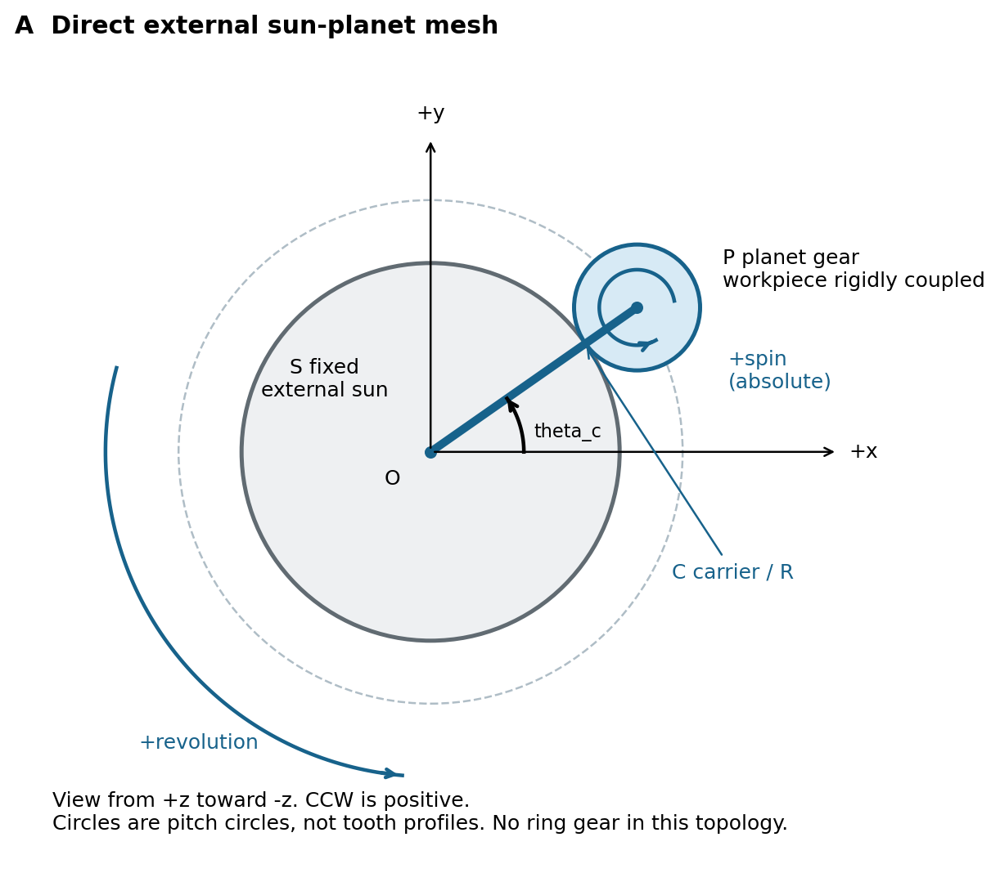
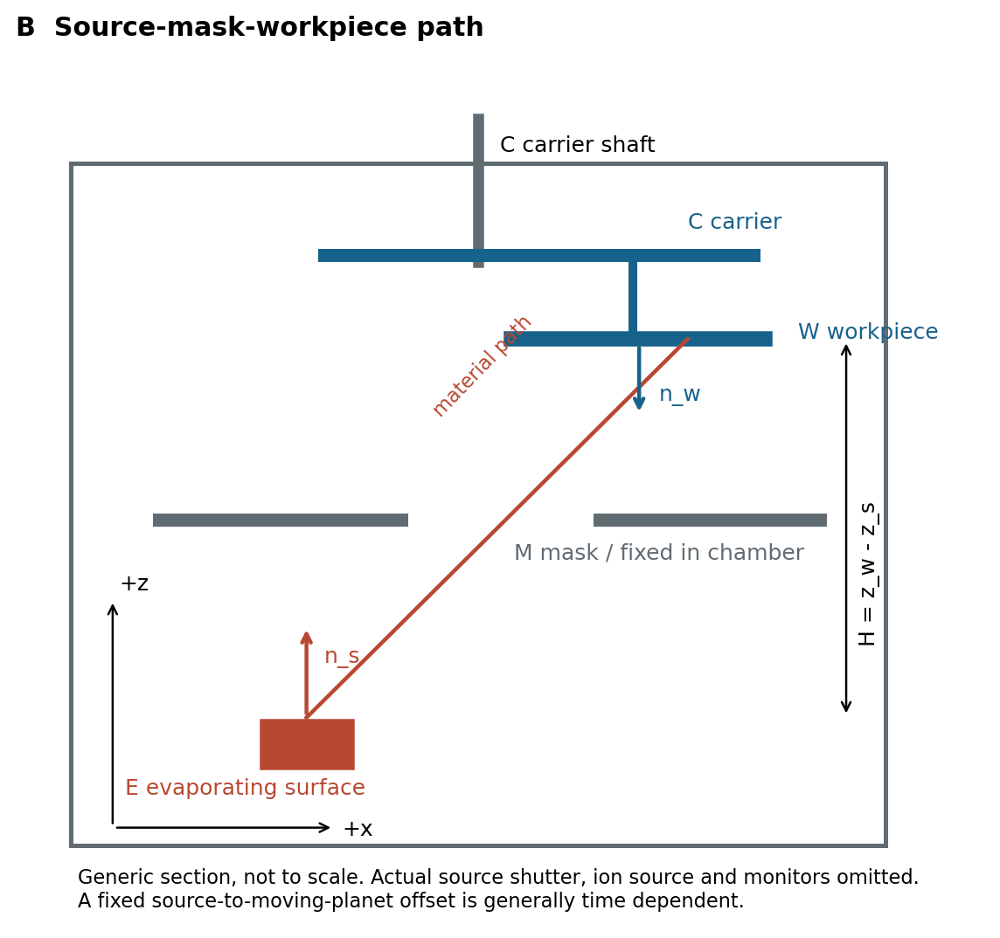

# 原创结构与坐标示意

以下示意由本研究绘制，不复制厂家图；不按实际尺寸，不代表用户机器制造图。SVG为矢量源，PNG为便于阅读的导出，两者表达相同内容。

## 图A 直接外啮合与坐标

- S：固定外齿太阳轮；图中圆为分度圆，不是齿顶轮廓
- P：外齿行星轮，本图假设工件轴与P刚性直连
- C：载架；R为O到P轴心的距离
- O：中心轴原点；+z朝向读者，沿−z看图，逆时针为正
- 虚线：行星轴中心轨道
- 两个正向箭头：公转和绝对自转在此条件下同向

本图不画内齿圈、惰轮或复合传动；一旦实机有这些结构，就切换章节03中的对应约束。图中工件与齿轮的“刚性直连”是姿态约束，不是声称它们具有相同半径。

## 图B 源 修正板与工件

- E：蒸发表面参考位置；红线为一条源到工件的物料路径
- M：腔体固定修正板；本图路径穿过其开口
- W：朝向源的工件被镀面；n_w是该面外法向
- n_s：本例源面的向上法向
- H：本例平面高度差z_w−z_s；红线斜距与H不同
- C：载架与驱动轴；未展开齿轮、真空穿轴及轴承

此图刻意省略源挡板、离子源和监控头，以讲清基本几何，不表示它们不重要。完整实机建模要把这些构件按所属坐标系加回。固定源与公转行星中心的相对偏置一般随时间变化，不能把某一瞬时“10 cm”当作不变全局向量。

## 从概念图转为实机图的最小步骤

1. 保留相同构件名称和坐标方向
2. 将示意位置替换为有来源及误差的尺寸，不从图上量像素
3. 标注每个构件固定在哪个刚体上
4. 画出所有可能截断物料、离子束或光路的构件
5. 同一图纸版本与过程run_id、夹具/修正板版本关联
