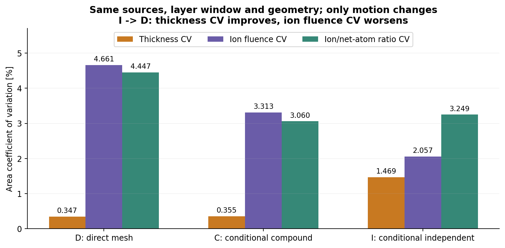

# T01 第二轮：运动拓扑与蒸气/离子双覆盖

版本0.1，2026-10-02 UTC。**有限理论与合成接口已完成，可带缺口移交；两类新增拓扑的原图核验未通过，实机资格未验证。**

## 结论先看

- 同几何、同源、同7.3秒层长，仅改输出运动，厚度CV可由1.469%改善到.347%，离子注量CV反而由2.057%恶化到4.661%。厚度均匀不能代替离子覆盖均匀
- 无板、仅蒸气板、仅离子板分别计算真实3D射线；板对两通道均不透明，选择性由路径分离产生
- D固定太阳轮直接外啮合为已有条件基线。C复合内齿圈、I独立驱动有一手文本依据，但未读到原图像素，明确标unsupported_figure_gate；没有把原创示意图当成原图证据
- 数值检查按预置预算停止；24项测试与一次窄数学复核完成。时间加密只覆盖21诊断点及独立三点，空间检查覆盖两级面积/边界采样；连续全域、实机和生产资格不在通过范围

## 阅读顺序

1. [结构、接触约束与闭合周期](chapters/01_topologies_and_constraints.md)
2. [坐标/时钟/参数与物理契约](chapters/02_shared_contract_and_physics.md)
3. [有限层结果与反例](chapters/03_results_and_counterexamples.md)
4. [数值、误差与停止边界](chapters/04_numerics_errors_and_stop.md)
5. [一次独立窄数学复核](reviews/独立窄数学核查.md)
6. [来源、访问限制和权利](sources/source_cards.md)
7. [T02第二轮有限移交建议](T02_ROUND2_HANDOFF.md)



## 复算

工作目录为本README所在目录。Python3.10+和NumPy即可运行核心、研究和测试；本次Python3.12.14、NumPy2.3.5。图需要Matplotlib，库版本在验证记录中另列。无需网络、无需第三方原文。

```sh
python -B -m unittest discover -s verification -v
python -B models/run_study.py
python -B reviews/independent_math_check.py
MPLCONFIGDIR=/tmp/t01_mpl_cache python -B diagrams/draw_figures.py
python -B verification/build_reader.py --check
```

run_study会覆盖本增量data中的生成结果和verification中的数值记录，不会改首轮、T02/T03/T10、产品项目或根STATE。参数定义是固定合成合同，不是接受任意实机结构的通用输入系统。若更改参数，应另存版本并重新明确数值/物理边界，不能沿用本次通过状态。

## 数据与交付

- [完整合成输入](data/synthetic_contract.json)、[有理数闭合](data/closure_periods.json)、[主汇总](data/main_summary.json)、[全盘总量](data/area_totals.json)
- 逐点CSV：[D](data/map_D.csv)、[C](data/map_C.csv)、[I](data/map_I.csv)；包括厚度、净原子面数、正离子注量、入射能量、积分比与独曝时长
- [单因素对照](data/single_factor_comparisons.json)、[均匀蒸气反例](data/uniform_thickness_counterexample.json)、[诊断点读数](data/diagnostic_readings.json)
- [预登记协议](verification/PRE_REGISTERED_PROTOCOL.md)、[数值记录](verification/numerical_checks.json)、[阶段验收与缺口](reviews/BOUNDED_ACCEPTANCE.md)
- 读者包：deliverables/T01_round2_topology_alignment_v0.1_reader.zip。由显式允许列表构建，只含原创内容/合成数据/代码与短摘要；不含第三方PDF、网页缓存或截屏

所有尺寸、齿数、通量、能量、密度与时序都是合成假设。历史120/36/37仅作条件教学；没有据此判断用户实机齿数优劣。专利公开结构不是自由实施意见，本研究不是加工、安装或运行指令。
