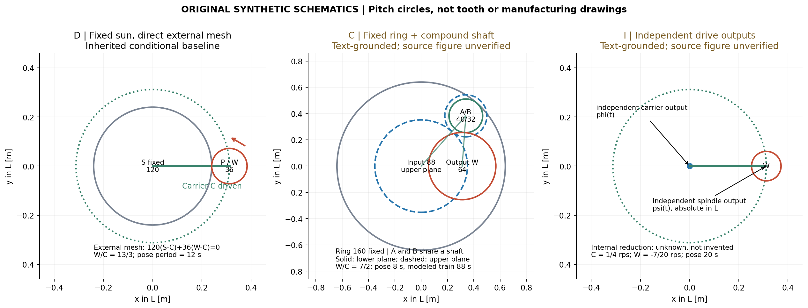

# 1 · 结构证据、独立约束与有理数闭合

## 1.1 本轮到底确认了什么

本轮保留D固定太阳轮直接外啮合基线，提出C固定内齿圈复合轮系与I独立驱动两个条件模型。C/I在一手文本中有明确连接依据，但原图像素核读未完成，预登记“源图核验”门槛记作unsupported；**不是三类实际结构全部验收通过**。原创图是研究推导示意，不能填补原图证据缺口。详见[来源卡](../sources/source_cards.md)。

| 模型 | 固定件 | 输入 | 工件输出 | 来源定位 | 本轮结构资格 |
|---|---|---|---|---|---|
| D | 外齿太阳轮S | 载架C | 与行星轮P直连 | US11608882B2，说明书Fig.1/3相关连接；承接首轮 | 继承条件基线，非用户实机 |
| C | 内齿圈R | 中央输入轮i；上/下a、b共轴 | 下轮b外啮合输出w，工件与输出轴直连 | US5776256A，Fig.1/2连接说明，权利要求3/4 | 文本有据；源图门槛unsupported |
| I | 腔体与驱动支承 | 独立公转与自转驱动 | 直接接受载架角φ和工件绝对角ψ | SVC 2009 pp.510–511，Fig.1/2说明 | 文本有据；源图门槛unsupported |

C来源中的支撑惰轮20A/20B不能仅因名称含“惰轮”就插到i→a/b→w的串联传动链里。I来源提及独立掩模驱动，本轮固定掩模试验不复现它，也不虚构内部减速齿数。齿轮、尺寸、源位、束场、板形与7.3秒过程全部是本研究合成输入。

## 1.2 同一个右手系中的接触约束

角速度均为相对腔体L的绝对角速度。转到载架参考系，记v_j=ω_j−ω_c。外啮合无滑动：Z_a v_a+Z_b v_b=0；内啮合：Z_R v_R−Z_b v_b=0。这里的正负号由接触点切向速度相等得到，与观察动画的方向无关。

### D：固定太阳轮直接外啮合

Z_s(ω_s−ω_c)+Z_p(ω_w−ω_c)=0。

故ω_w=ω_c+(Z_s/Z_p)(ω_c−ω_s)。固定太阳轮ω_s=0，ω_w/ω_c=1+Z_s/Z_p。载架正向时输出同向；载架停止且太阳轮固定时输出停止。120/36、15 rpm仅是教学参数，得到65 rpm；不是历史用户机器识别结论。

### C：固定内齿圈和共轴复合轮

独立的三个约束为：

- 内啮合：Z_R(ω_R−ω_c)−Z_b(ω_b−ω_c)=0
- 共轴：ω_a=ω_b；输入外啮合：Z_i(ω_i−ω_c)+Z_a(ω_b−ω_c)=0
- 输出外啮合：Z_b(ω_b−ω_c)+Z_w(ω_w−ω_c)=0

令ω_R=0，则：

ω_b/ω_c=1−Z_R/Z_b

ω_i/ω_c=1+Z_a Z_R/(Z_i Z_b)

ω_w/ω_c=1+Z_R/Z_w

这说明i/a的选取影响输入速度如何变为公转，但在已固定ω_c时，w/c由内齿圈与输出齿数决定。不能把太阳轮公式中的120/36机械地套到所有齿轮名称上。本合成取R=160、b=32、a=40、i=88、w=64，所以ω_b=−4ω_c、ω_i=(36/11)ω_c、ω_w=(7/2)ω_c。为公平比较指定载架15 rpm，输入应为540/11≈49.0909 rpm，输出52.5 rpm。实际设备输入转速未识别。

### C不能只满足速度，还要能满足中心距

合成同模数m=0.008m，分度半径为R圈0.640、b轮0.128、a轮0.160、i轮0.352、w轮0.256m。复合轴到中心距离既等于r_R−r_b=0.512m，也等于r_i+r_a=0.512m；复合轴到输出轴距离为r_b+r_w=0.384m。

输出轴为(0.312,0)，可取复合轴B=(0.339794872,0.382992748)m，满足以上两距离。输出轮包络0.312+0.256=0.568<0.640m。输入/上轮和下轮/输出轮分属不同高度。这个检查只证明理想分度圆中心距可行，不证明齿顶/根切、轴承、壳体、支撑惰轮、应力、污染或安装安全均可行；它不是加工图。

### I：独立输出，不把独立驱动绑回一个速比

φ(t)=φ₀+2πf_c t，ψ(t)=ψ₀+2πf_w t。主例f_c=1/4转/秒、f_w=−7/20转/秒，比值−7/5。输入契约直接保存两个输出速度；当f_c=0时仍允许f_w=−7/20，不能因比值乘零而抹掉独立自转。内部电机转速和输出之间的减速比unknown，故本轮不预测电机电流、转矩或控制精度。

## 1.3 刚体链与法向

平行轴主算例：c(t)=(R cosφ,R sinφ,H)，Q(t)=R_z(ψ)，x=c+Qξ，n=Q n₀。主面n₀=(0,0,−1)，故法向恒朝下；位置和标记方向仍随ψ变化。测试另用倾斜局部面法向检查旋转，未冒充非平行轴传动。

共同转动和平移整个场景时，x、源、板中心和探头位置都执行x′=Q_g x+a，法向、束轴与板基向量只执行n′=Q_g n，双通量应不变。已核查此不变性。非平行轴应使用完整乘积旋转，不能把φ与某局部倾斜轴角简单相加；本轮未实现该类运动。

## 1.4 有理数闭合必须声明闭合的对象

若固定频率f_j都是精确有理数，取其分母最小公倍数L，令k_j=L f_j为整数，则所有被纳入的标记角状态最小正周期为T=L/gcd(|k_j|)。全部静止时任何T都可用，不存在最小正周期。对工件位置与带标记朝向，只纳入f_c、f_w即可；仅看无标记圆盘占据的空间集合可更早重复。

| 条件模型 | 工件绝对转速rpm | 标记工件位姿周期 | 本轮建模齿轴集合周期 |
|---|---:|---:|---:|
| D 120/36，15 rpm公转 | 65 | 12 s（3公转） | 12 s |
| C 合成复合轮系 | 52.5 | 8 s（2公转） | 88 s（22公转，含输入轮） |
| I 独立输出 | −21 | 20 s（5公转） | 仅两个已知输出角，20 s |
| 历史120/37教学对照 | 约63.64865 | 148 s（37公转） | 不对应已识别实机 |

C的88秒**不是实际全机构的已验证周期**：支撑惰轮齿数、电机转子及其他未建模轴未知。源速率、能量、挡板日志或材料状态若不具此周期，双覆盖积分也不因工件闭合自动成为周期过程。

SVC论文提供独立驱动的结构依据，但其p.512所列部分十进制速比的重复圈数不能直接作算法真值。在“速比等于精确十进制、有标记刚体”的定义下：0.82=41/50应50圈；0.83=83/100应100圈；0.87=87/100应100圈。原文主述约−0.86，p.514图注文本为−0.086，两者闭合圈数分别50和500；本研究不替作者判定哪一个是实际设定。此处是独立有理数算术复核，不用原文的周期或性能断言为本例背书。

长周期只说明相位重访，不保证有限层均匀性。主例7.3秒短于上述三个工件周期，比较使用相同秒数，绝不各跑一个周期再把总沉积量相互比较。
