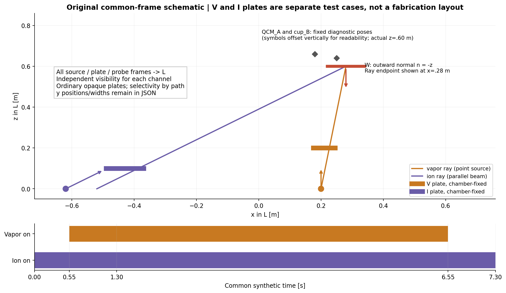

# 2 · 统一坐标、公共时钟与双覆盖物理契约

完整可机读输入：[synthetic_contract.json](../data/synthetic_contract.json)。没有从用户机台、论文曲线或专利图像量取尺寸。所有数值是合成假设，长度m、角度rad、时间s、速度有理数转/秒；薄膜连续密度也是任意教学值。

## 2.1 归属与观测定义

| 对象 | 机械归属 | 主例定义 | 必须保留的区分 |
|---|---|---|---|
| 蒸气点源 | 腔体L | (0.20,−0.08,0)m，源法向+z | 发射法向与基片接收法向不同 |
| 离子束 | 腔体L | 入口基准(−0.62,0.04,0)m，传播方向(0.8,0,0.6) | 入射能/粒子通量是束法向面积基准，投影一次 |
| 工件盘 | 输出轴W | 中心轨道R=.312m，H=.60m，盘半径.06m | 坐标局部点跟随W，不能把固定空间点当片上点 |
| V板 | 腔体L | z=.20m的零厚矩形 | 普通不透明板，对两通道都求交 |
| I板 | 腔体L | z=.10m的零厚矩形 | 通道选择性由几何分离造成，不是粒子识别功能 |
| QCM_A | 腔体L | (.25,−.20,.60)m，法向−z | 只读自身局部留存响应，无片上tooling factor保证 |
| cup_B | 腔体L | (.18,.04,.60)m，法向−束轴 | 已按杯面投影；不能随后重复乘cos |

矩形板的中心、正交u/v基与法向完整写入JSON。当前两板归属均为L；载架或工件随动板只作为将来契约，不是本脚本已支持的动态实体。法向必须单位化且彼此正交；本包是固定输入参考，不是可任意填入几何的通用验证器。

公共时钟为合成t=0，层窗[0,7.3]；蒸气门为[.55,6.55)，离子为[0,7.3)。先有.55秒离子独曝，最后还有.75秒，板可另外改变局部独曝时长。积分保留真实秒数，半开区间只避免端点双计，零测度端点不改变理论积分。实际设备需另填编码器零相位、触发延迟、采样时钟偏差与插值规则，本轮并未估计这些值。

## 2.2 三维射线与物理通道分离

从点源s到片点x的蒸气路径为s+λ(x−s)。板平面过m、法向n_m，交点λ=n_m·(m−s)/[n_m·(x−s)]。只在0<λ<1且交点位于实际板u/v矩形内时遮挡；边缘算不透明，共面平行薄板射线按不遮挡约定。本轮没有厚板侧壁、扩展源半影、支架与自遮挡。

平行离子束反投影回通过入口基准、法向为束轴的入口平面，得到独立起点，再用同一个三维板求交器。**所有板对两通道都不透明**。主例工件|x|≤R+a=.372m：

- 在V板z=.20处，离子路径x至多.372−(.4/.6)×.8=−.16133m，而V板x∈[.175,.245]，不相交
- 在I板z=.10处，蒸气路径x∈[.10467,.22867]，I板x∈[−.49,−.37]，不相交

因此“仅遮蒸气”和“仅遮离子”是实际射线几何上的三种合成案例；没有使用按通道强行透明的普通实体。若更换源场或板位，这个分离结论必须重新证明。本轮的均匀平行蒸气反例只用无板；瞬时通量可处理其独立平行射线，但事件积分明确拒绝“平行蒸气+板”，不会静默复用点源遮挡事件。

## 2.3 两个独立通量

点蒸气源采用合成cosine分布：

Γ_v(x,n)=Γ_v,ref H_ref² max(n_s·d_v,0) max(−n·d_v,0)/|x−s|²。

Γ_v,ref=2×10¹⁹原子/(m²s)，H_ref=.60m。这里是局部核的参考标度，不声称已做真实总蒸发质量归一化。源、接收面双投影与逆平方距离都保留。

离子束以d=(.8,0,.6)、e₁=(.6,0,−.8)、e₂=(0,1,0)为正交基，ρ₁=(x−s_i)·e₁、ρ₂=(x−s_i)·e₂：

Γ_i=Γ_i,0 exp[−(ρ₁²+ρ₂²)/(2σ²)] max(−n·d,0)。

Γ_i,0=2×10¹⁸离子/(m²s)，σ=.13m，场只在入口平面下游存在。入口高斯无硬半径截止；很小但非零通量仍按正值计，独曝时长不是超过工艺剂量阈值的时长。单电荷、单能100 eV、无快中性均为本例假设，不能继承为Kaufman通用事实。

## 2.4 积分输出以及不允许混淆的分母

本例留存系数1、再溅射产额0，故Γ_net=Γ_v；这只是关闭了材料过程的一项明确假设，不能由QCM增长反推真实入射原子流。净原子密度取8×10²⁸m⁻³，厚度h=N_net/n_atom；主均值约.76nm，仅为连续模型教学量，不是该亚纳米膜能形成均匀连续实膜的证据。

每一个工件局部点输出：

- N_net=∫Γ_net dt：净原子面数，m⁻²；h以nm输出
- D_i=∫Γ_i dt：正离子注量，m⁻²
- U_inc=e∫E_iΓ_i dt：入射离子动能面密度，J/m²，不是吸收热量
- R=D_i/N_net；ε=(∫E_iΓ_i dt)/N_net，eV/净原子
- τ_ion-only=∫1(Γ_i>0且Γ_net=0)dt

N_net≤0时R与ε不可定义，内部NaN、CSV空值/JSON null，不包装为0或有限收益。允许有限层中有零沉积的离子独曝时段，只要整层净沉积为正；瞬时R无定义不妨碍整层积分比有定义。积分比不等于瞬时比的时间平均。

同样，面积平均的局部R不等于总离子数/总净原子数。主表的R是前者；[area_totals.json](../data/area_totals.json)另给实际盘面积、总净原子数、总离子数、入射动能总量和总量之比。圆盘面积均值使用r²变量的Gauss求积；边缘见证点面积权重为0，仍参加采样峰谷，不能把边缘重复计面积。

## 2.5 与既有专题的对接限制

T02需要接入pose、两源节点、两独立visibility、同一clock与observation；不要让源模块从齿轮名称推测输出角。T03必须分别约束h、D_i、R/ε和吞吐，不得只最小化h的CV。T10应能替换Γ_i为按粒种/电荷态/能谱拆分的真实计量量，同时保留快中性缺项和净留存分母；本代码不假装已实现这些输运过程。

n/k、应力、致密度、吸收、附着、温度、再溅射及真实材料响应都未从覆盖图推得。理论同坐标接口能成立，真实误差上界与实机资格仍未知。
