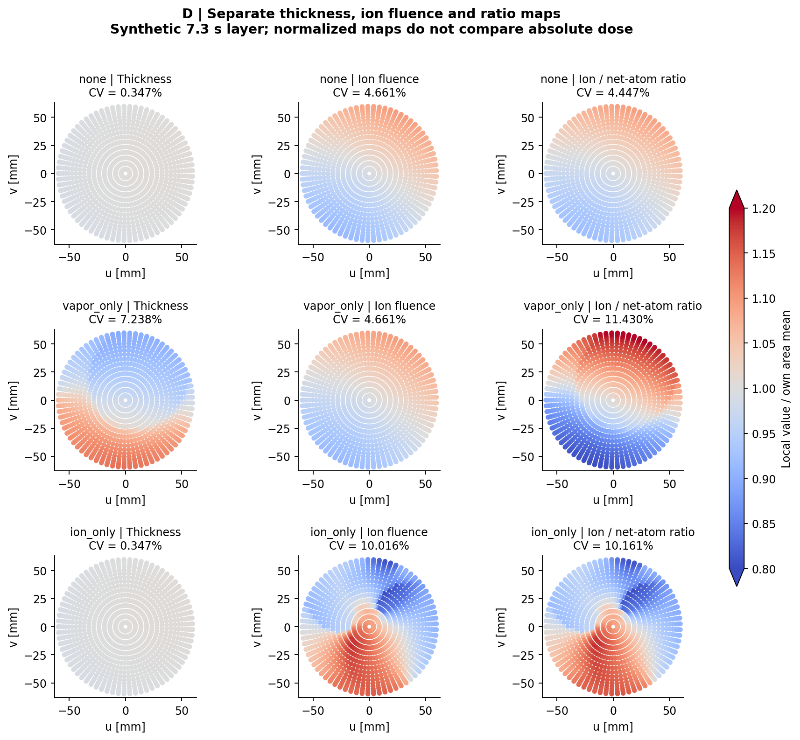

# 3 · 有限层结果、反例与单因素对照

所有结果都是固定输入下的合成数值。C/I仍是源图未核验的条件模型。使用最终18×73面积节点、145边界点及中心见证点；后两者面积权重为0。CV=面积加权标准差/均值；采样PV在数据文件另报，不是连续域极值证明。

## 3.1 主算例：同7.3秒，不用各自闭合周期代替层长

| 模型 | 板案例 | h均值 nm | h CV % | 离子注量均值 10¹⁸/m² | 注量 CV % | R面积均值 | R CV % | 离子独曝均值 s |
|---|---|---:|---:|---:|---:|---:|---:|---:|
| D | none | 0.762679 | 0.347 | 1.594006 | 4.661 | 0.026123 | 4.447 | 1.300000 |
| D | vapor_only | 0.667625 | 7.238 | 1.594006 | 4.661 | 0.030089 | 11.430 | 1.716673 |
| D | ion_only | 0.762679 | 0.347 | 1.280860 | 10.016 | 0.020996 | 10.161 | 1.158068 |
| C | none | 0.762679 | 0.355 | 1.594006 | 3.313 | 0.026123 | 3.060 | 1.300000 |
| C | vapor_only | 0.667612 | 7.683 | 1.594006 | 3.313 | 0.030090 | 10.715 | 1.716735 |
| C | ion_only | 0.762679 | 0.355 | 1.280934 | 11.261 | 0.020992 | 11.183 | 1.158090 |
| I | none | 0.762679 | 1.469 | 1.594006 | 2.057 | 0.026136 | 3.249 | 1.300000 |
| I | vapor_only | 0.667616 | 4.093 | 1.594006 | 2.057 | 0.029894 | 4.510 | 1.716719 |
| I | ion_only | 0.762679 | 1.469 | 1.281015 | 9.907 | 0.020986 | 9.385 | 1.158147 |

数据：[完整主汇总](../data/main_summary.json)、[全盘总量](../data/area_totals.json)、[D逐点CSV](../data/map_D.csv)、[C逐点CSV](../data/map_C.csv)、[I逐点CSV](../data/map_I.csv)。入射能量为100 eV×离子数，故能量注量CV与离子注量CV相同；ε=100R，因此ε的CV与R相同。这个相等来自单能假设，不是一般离子源性质。

## 3.2 严格的非等价反例

在无板、相同源、几何、工件初位姿、时序与层长下，由I运动切为D运动：h的CV由1.469%降至0.347%，D_i的CV却由2.057%升至4.661%；R的CV由3.249%升至4.447%。因此“厚度更均匀”不蕴含“离子剂量更均匀”。这不是全局优劣排序，不是齿轮更换建议；I本身是源图待核的输出运动条件模型。

三运动的无板面积平均厚度和离子注量相同，并非抄用同一结果：完整圆盘在自转时占据的空间集合不变，任一时刻面积平均与自转角无关；各材料点的累积历史不同，CV仍可改变。板案例面积均值的微小差异来自有限面积求积，不能过度解释为物理吞吐差异。

另有预登记的解析辅助反例：D运动保持不变，仅把点蒸气源场替为均匀平行蒸气，无板。厚度精确1.5nm、CV≈0，离子注量逐点完全相同、CV仍4.661%。这是源场不同的逻辑反例，与上面的纯运动对照分开；不把它说成修正板能实现的效果。[完整记录](../data/uniform_thickness_counterexample.json)

## 3.3 板改善厚度的预期没有出现，如实保留

本次固定蒸气板未经优化，三运动下都恶化厚度CV，不能称作“修正成功”。D中h均值从.762679降至.667625nm，h CV从.347%升至7.238%，离子注量不变；额外蒸气遮挡使R CV升至11.430%、平均离子独曝增加至1.716673s。仅离子板保持厚度逐点不变，却把D_i CV升至10.016%。这些负例保留，没有改板形挑选更好的结果。色图按各自面积均值归一化；相同颜色不代表绝对剂量相同，超出0.8–1.2色标的值以端色饱和。

## 3.4 起止相位与源场必须隔离

固定D与12×48面积网格，只改一个因素；这些是预定灵敏度演示，未对每个新场景另做完整空间收敛。完整结果见[single_factor_comparisons.json](../data/single_factor_comparisons.json)。

- 层终点改为1.3s，其他门控时间原样截取：有效沉积仅.75s。无板h CV为3.569%、离子注量CV7.986%，R CV11.461%；不能把主层结论外推到最薄层

- 仅载架初相位增加π/3，工件绝对初角不变：无板h CV为.398%、注量CV6.474%，均值也改变。这隔离的是载架起相位，不是把源和工件整体旋转，更不是保持相同工件相对载架相位的另一种实验

- 仅高斯束σ从.13改为.18m，保持峰值：无板h完全不变，注量CV降至1.028%，注量均值升至2.995477×10¹⁸/m²。峰值固定意味着总束通量也增大，不能把绝对剂量提升全部归因于形状而声称等功率比较

结构/运动、源场和相位的对照已经分离；没有把未知材料响应拟合进任何变量。诊断读数另存[diagnostic_readings.json](../data/diagnostic_readings.json)，探头值不等于工件面积均值。
