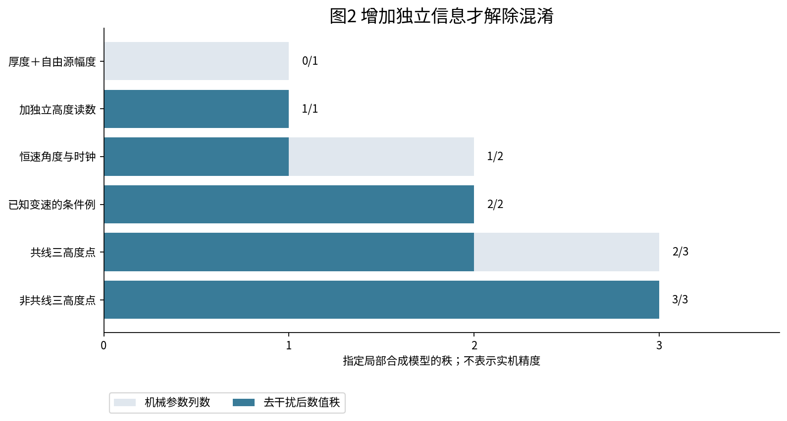

# T01第三轮 行星机构机械误差与可观测校准

版本T01-r3-v0.1.0，2026-10-02 UTC。**本地有界理论与接口完成；实机未验证，正式指定模型审核链未执行。**

厚度图并不总能反推机械原因。本轮新增三个可复算结论：自由源幅度可完全吸收一个简化高度误差；恒速角记录无法分开零相位与时钟偏差；共线高度测量留有看不见的倾角。应先补独立观测，再谈机械修正。

固定太阳轮120齿与行星36/37齿保留；实际拓扑、模数与中心距仍未知。本轮没有重做前两轮CV，没有将合成例解释成用户实测，也没有提出实际改机参数。

## 阅读入口

可直接用浏览器打开[离线完整阅读版](reader.html)，不需服务器或联网；浏览器页面排版截图未取得，三张图的PNG已逐张查看。

1. [边界与误差分类](reports/01_scope_and_error_taxonomy.md)
2. [位姿 法向 回差与事件接口](reports/02_pose_and_contact_model.md)
3. [观测方程与混淆反例](reports/03_observation_and_identifiability.md)
4. [测量设计与真实数据需求](reports/04_measurement_design.md)
5. [接口契约与独立复算](reports/05_interface_and_reproduction.md)
6. [结果 验证及未决边界](reports/06_results_and_acceptance.md)
7. [六项主来源短摘要](sources/research_notes.md)、[一次独立核查](reviews/INDEPENDENT_REVIEW.md)、[修复与定点重放](reviews/AUTHOR_FIXES_AND_REPLAY.md)
8. [T02第三轮候选](T02_ROUND3_HANDOFF.md)，未启动



## 已验证与未验证

- 31个轻量unittest通过；一次窄独立核查另用四元数、联合信息矩阵逆和严格零向量
- 独立发现的CSV额外字段、clock map后溢出/重合已拒绝；病态干扰子空间返回未决，不制造有限机械协方差
- 初始失败证据保留，最终作者定点重放通过；并未反复扩大review
- 所有正式反演、全盘积分、设备运行和生产资格均未执行；完整精度计划保留plan_only
- 读者ZIP不含第三方原文、账户标识或父目录依赖。NASA公开报告合法本地归档，未纳入公开清单

## 复算

在本目录或ZIP解压目录执行；Python3.10+，NumPy1.24–2.x。命令默认只读，不改冻结输出：

```
python -B verification/reader_check.py --check
python -B -m unittest discover -s verification -v
python -B models/run_examples.py
python -B models/offline_read.py data/synthetic_observations.json --allow-synthetic
python -B models/prepare_calibration_plan.py
python -B reviews/independent_checks.py
```

测量模板`data/measurement_template.json`故意不可拟合；缺的数值保持null。重执行计划有完整误差轴与停止状态，预算/设备/真实目标未明确时不启动。绘图再生成另需Matplotlib与Noto CJK字体，reader及数值复算不依赖这些工具；HTML重新构建需Pandoc。

本地归档：deliverables/T01_round3_mechanical_error_observability_v0.1.0_reader.zip。精确允许列表为verification/public_allowlist.txt，内容manifest为verification/reader_manifest.json；ZIP外另有receipt避免自引用。完整性校验不代表数字签名或设备资格。
