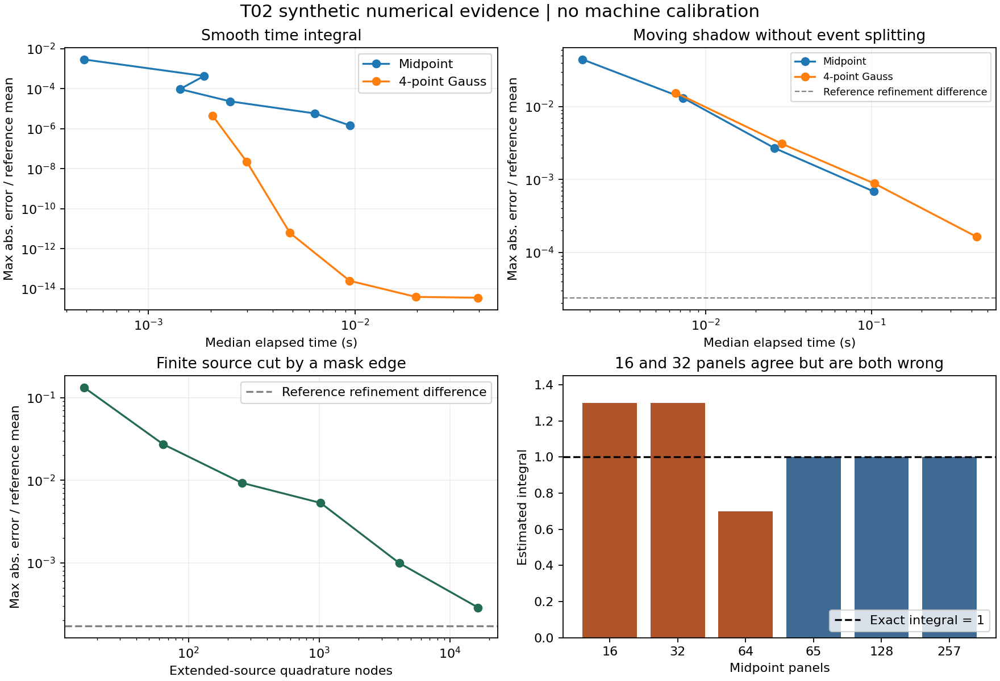

# 05 解析验证 数值基准和已知失效

本章报告首轮真实执行结果，所有设备、材料和时间参数均为合成演示假设。它回答“实现是否按模型算对”和“特定算例要多少计算量”，不回答“用户实机能达到多高精度”。理论/代码验证与实验验证的区分参考[NASA模型仿真标准M08](https://standards.nasa.gov/standard/NASA/NASA-STD-7009)，本库不宣称获得该标准认证。

## 1 解析与边界回归

`verification/verification_results.json`记录34项检查全部通过。包含4种发射指数的半球归一化、平面膜厚解析曲线、距离平方律、源与工件背面、有限接收盘捕获比例、均匀圆盘源轴上闭式解、点源极限、整体坐标变换不变性、真实掩模平面、实体板侧壁、线段外遮挡、半影对称性、36/37位姿闭合、倾斜法向及刚体距离、时长/速率/密度单位、挡板分段、球冠面积和非法输入。

独立数学复核另行检查了倾斜接收平面的解析核、圆盘节点二阶矩、运动链与厚板求交，未发现核心公式问题。它发现零质量源节点恰与工件点重合时会触发不必要的奇异性异常；现已在Source构造时剔除零权节点，并增加对应回归，复核记录已关闭。此记录是真实执行的窄范围数学审查，不冒充未实际运行的指定模型签署。

所有数值阈值逐项写在脚本和JSON中：例如解析核相对差通常要求10⁻¹⁴量级，位姿闭合绝对位置差≤10⁻¹³m。这是简单双精度合成算例的代码检查容差，绝不是实际设备的机械/厚度精度要求。

## 2 光滑时间积分的速度与误差

几何为a=0.312m、H=1m、工件环半径0.15m、72点、载架15rpm和120/36理想外啮合；源在(0.1,0,0)m，p=2。时长7.3s，质量率均值10⁻⁶kg/s，叠加0.25Hz和1.7Hz调制；密度3000kg/m³仅用于单位演示。没有把这些值解释为任何指定材料或机器参数。

误差为`max|h−h_ref|/mean(h_ref)`。参考解使用16384个时间面板、每面板4点；相对前一倍粗参考的差为 3.445e-15。下表是本次运行的中位时间，均先预热，再连续测3次；原始CSV另含最小/最大值。毫秒级计时会有负载噪声，不应据单点排序推断算法复杂度。

| 每面板阶次 | 时间节点 | 误差比例 | 中位时间s |
|---|---|---|---|
| 1 | 64 | 9.451e-05 | 1.420e-03 |
| 1 | 256 | 5.750e-06 | 6.397e-03 |
| 1 | 512 | 1.435e-06 | 9.473e-03 |
| 4 | 64 | 4.445e-06 | 2.044e-03 |
| 4 | 128 | 2.189e-08 | 2.994e-03 |
| 4 | 256 | 6.156e-12 | 4.842e-03 |

在这个光滑算例，相同64个时间节点下，4点Gauss优于中点法；但超过圆整误差底后继续加密不再提供有意义的精度。这个结论的条件是函数平滑、频率已解析和所需几何完全一致。它不是对所有遮挡工况的统一加速保证。

## 3 移动阴影和扩展源半影

移动矩形板的二值可见性产生跳变，本轮故意不求精确边界穿越时刻。最高参考为65536面板×4点，对32768面板×4点的差仍为 2.386e-05。因此对更小误差不能报告超出参考分辨率的有效数字，也不能把参考当成解析真值。

| 每面板阶次 | 时间节点 | 误差比例 | 中位时间s |
|---|---|---|---|
| 1 | 1024 | 2.691e-03 | 2.601e-02 |
| 1 | 4096 | 6.852e-04 | 1.029e-01 |
| 4 | 4096 | 8.804e-04 | 1.039e-01 |
| 4 | 16384 | 1.636e-04 | 4.292e-01 |

与光滑算例相比，高阶方法的优势明显减弱；同节点数的中点与Gauss比较还可能反转。工程升级应考虑可靠的事件定位或几何边界分区，而非无限提高积分阶数。

扩展圆盘源跨不透明边缘的面积积分同样不连续。本轮最高源参考192×768=147456节点，比128×512节点的差为 1.728e-04。源面积64×256=16384节点结果的误差已接近该参考不确定的量级，不能据此宣称万分之一精度通过。

| 源节点 | 误差比例 | 中位时间s |
|---|---|---|
| 16 | 1.327e-01 | 8.605e-05 |
| 64 | 2.738e-02 | 1.216e-04 |
| 256 | 9.314e-03 | 4.287e-04 |
| 1024 | 5.319e-03 | 1.247e-03 |
| 4096 | 9.923e-04 | 5.361e-03 |
| 16384 | 2.872e-04 | 2.116e-02 |

图示从CSV重建。左上为光滑时间积分；右上为移动阴影；左下为扩展源半影；右下为两级网格同错的混叠反例。虚线参考加密差是经验差异，不是严格误差界。所有图均不使用实机测量。

## 4 两个收敛陷阱

**同错的双网格。** `1+0.3cos(2π64t)`在1s内的精确积分为1；16和32个中点都得到1.3，相互差0却同错30%。用65点得到1至圆整精度。由此禁止只凭N与2N一致就“验收”高频源率或细窄遮挡。

**平均值收敛而峰谷未收敛。** 曲面工件面积求积的合成结果如下，均值相对高分辨率参考变化已极小，但采样峰谷仍随节点数上升。原因是Gauss点不含边界、粗点集可能漏掉极值；用于均匀性验收的输出网格必须另做边缘/极值加密。

| 工件采样点 | 面积均值相对误差 | 采样PV比例 |
|---|---|---|
| 16 | 9.157e-09 | 0.074186 |
| 64 | 9.753e-16 | 0.100297 |
| 256 | 1.393e-16 | 0.108760 |
| 576 | 1.393e-16 | 0.110302 |

## 5 36与37齿比较中的条件与混淆

同一源模型、起始相位、质量率、时间窗和环上72点，先固定a=0.312m只改转速比，再对37齿加入标准同模数中心距a=0.314m。下表取恒定速率，指标只属于这个环；没有给出整个圆盘的均匀性。

| 时长s | 齿数 | 中心距m | 环PV百分比 | 环均厚nm |
|---|---|---|---|---|
| 0.75 | 36 | 0.312 | 18.191682 | 0.097457 |
| 0.75 | 37 | 0.312 | 18.994812 | 0.097457 |
| 0.75 | 37 | 0.314 | 19.112553 | 0.097250 |
| 7.3 | 36 | 0.312 | 0.903016 | 0.865388 |
| 7.3 | 37 | 0.312 | 0.163785 | 0.865388 |
| 7.3 | 37 | 0.314 | 0.166284 | 0.863128 |
| 12.0 | 36 | 0.312 | 0.000000 | 1.439274 |
| 12.0 | 37 | 0.312 | 0.953622 | 1.439274 |
| 12.0 | 37 | 0.314 | 0.961594 | 1.435611 |

0.75s下37齿在本例更差，7.3s下更好，12s下36齿接近数值均匀而37齿尚未完成其闭合周期。这足以反证“长重复周期的齿数必然更均匀”的无条件断言；不能反过来把此表当作36齿普遍更优的证据。接近浮点零的值来自此合成源场与周期组合，不是任意源场的均匀性定理。

固定中心距的37齿行与联动中心距的37齿行不同，说明必须区分运动相位与几何变化。参考CSV还包含60s、148s及0.25Hz速率调制，便于重算；未声称任何实际产品性能提升比例。

## 6 可辨识性证据与接受边界

`identifiability.json`中41个平面厚度位置对`logA,p,q`的合成雅可比秩为2，最小奇异值约3.7×10⁻¹⁷；对`logṀ,logc,logρ`的尺度雅可比秩为1。测点更多不能修复这些结构退化，必须改变观测或明确只识别组合参数。

本轮因此接受“理论模型、数值方法、合成验证与标定协议可复用”，并冻结为v0.1；不接受“已在真实设备达到某个厚度误差”“已证明某齿数更优”“已完成任意CAD/散射/微结构模型”。本轮边界内没有未关闭的核心公式缺陷；物理数据缺口按跨专题适配任务登记，不无限延长当前理论阶段。
