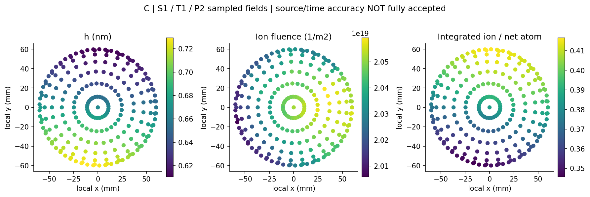

# T02 第二轮 扩展源与有限厚板双覆盖误差预算

版本0.1，2026-10-02 UTC。**有限理论与合成接口已完成，数值精度按 partial_numerical_acceptance 冻结。没有实机验证或生产资格声明。**

## 先看结论

- D直接外啮合基线接通两类有限源、各自射线、有限厚实体和共同时间；C/I原图仍unsupported
- 相同厚度图可对应不同离子注量：明确无再溅射合成例中，离子源率×2，厚度逐点不变，离子注量及入射动能×2
- 解析盘源、点源/薄板回归、20项单元检查通过其限定条件；独立六面求交与slab的60,000条普通随机射线一致
- 源与时间加密仍有未达项：最高两源求积族主要积分差0.203%，离子独曝时长差14.3 ms，超过10 ms门槛。空间均值平稳不等于整个模型收敛
- 极近侧壁浮点漏挡和“两欠采样网格一致但误差80%”反例原样保留。完成预设清单后停止，没有为了全通过继续加密

## 工程增补报告

1. [统一模型 合同与有限厚板](reports/01_engineering_model.md)
2. [四组合成例 数值证据与反例](reports/02_numerics_and_evidence.md)
3. [科学误差预算和适用边界](reports/03_scientific_error_budget.md)
4. [一次独立窄数学检查](reviews/INDEPENDENT_NARROW_REVIEW.md)
5. [来源摘要 权利和访问](sources/source_cards.md)
6. [T03第二轮移交方案](T03_ROUND2_HANDOFF.md)



## 复算

工作目录为本README所在目录。Python3.10+、NumPy；图另需已安装的Matplotlib。本轮Python3.12.14、NumPy2.3.5，无新安装依赖。

```sh
python -B -m unittest discover -s verification -v
OPENBLAS_NUM_THREADS=1 OMP_NUM_THREADS=1 python -B models/run_study.py
OPENBLAS_NUM_THREADS=1 OMP_NUM_THREADS=1 python -B reviews/independent_narrow_check.py
MPLCONFIGDIR=/tmp/t02r2_mpl python -B diagrams/draw_figures.py
python -B verification/build_reader.py --check --reader
```

无ZIP的GitHub目录或解压读者包，可用上述--check --reader只核对明列文件及独立SHA-256清单；不需要原工程目录或第三方原文。去掉--reader时若本地ZIP存在，还会逐字节核对ZIP。检查模式不写文件。reader_manifest不哈希自身以避免自引用；外部release_checks.json另含其哈希，这些是完整性校验而非作者身份签名。

主脚本只覆盖本增量data与verification中的生成结果，不修改首轮或其他专题。复制的frozen模块只通过本增量适配器使用；原T01的load_config等相对路径便利函数未改为可单独调用。明确入口是models/dual_finite.py与models/run_study.py，不是任意机台输入解析器。

## 数据与交付

- 合成输入和冻结依赖：[synthetic_contract.json](data/synthetic_contract.json)、[frozen_dependencies.json](data/frozen_dependencies.json)
- 完整结果：[results.json](data/results.json)，包含失败级、预算、有效面积比例和参考精度状态
- 逐点主图：[C_main_map.csv](data/C_main_map.csv)，其固定S1/T1未完全满足源/时间要求
- [诊断留出](data/C_diagnostic_holdout.csv)、[单轴比较](data/C_axis_comparisons.csv)、[八角交叉运行](data/C_cross_runs.csv)、[交叉比较](data/C_cross_comparisons.csv)
- [半影剖面](data/B_penumbra.csv)、[几何情景](data/C_geometry_scenarios.csv)、[误差预算](data/error_budget.csv)
- [预登记](verification/PRE_REGISTERED_PROTOCOL.md)、[有限验收](reviews/BOUNDED_ACCEPTANCE.md)、[公开精确允许列表](verification/public_allowlist.txt)
- 离线读者包：deliverables/T02_round2_dual_coverage_error_budget_v0.1_reader.zip

所有彩图为原创合成图。读者包只含明列的原创研究、短摘要、代码和合成数据；无第三方全文、原图、网页缓存或凭据。合法原文继续保留在既有专题本地档案，未重复复制或公开。报告中的工程示意不是实机结构图。
