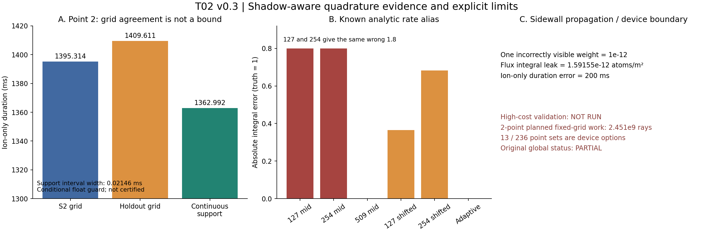

# T02 v0.3 阴影不连续求积控制增补

2026-10-02 UTC。**本地算法与小核证据交付；高算量验证待设备。全局仍partial，无physical certification。** 不覆盖v0.1/v0.2，不修改根状态，不启动T03优化，不上传或推送。

## 结论先读

- 原0.202989%源求积族差定位到诊断点12的离子注量/能量。新的连续源参考尚未执行完成，不能宣布这一项闭合
- 原14.297ms时长差定位到点2。连续源支集事件给出条件区间 **[1.362981129, 1.363002586]s**，宽0.021458ms。旧S2与留出分别偏约 **32.322ms、46.619ms**；两网格差并非误差上界
- 支集包络用全区间Lipschitz排除，不只是扫点找根；但binary64三角函数、凸包与1e-11m浮点guard未用严格区间算术验证，所以是**条件数值包络**，不是严格认证
- 同错alias、高频rate边界与近侧壁漏挡传播均保留。少量错误可见通量能造成有限独曝时长跳变，不能用积分误差小替duration通过
- 按用户新增“高计算量算法先写、之后设备验证”要求，完整嵌套参考运行中断。只留下点2蒸气base结果，tight及点12离子参考标not_run；高精度/大网格driver写完但未执行

## 阅读与复现

1. [投影、解析降维与支集方法](reports/01_method_and_controls.md)
2. [证据、算量、剩余问题和T03边界](reports/02_results_and_t03_boundary.md)
3. [可复用停止/告警协议与设备验证](reports/03_stop_alert_device_protocol.md)
4. [一次窄独立数学检查](reviews/INDEPENDENT_CHECK.md)
5. [来源摘要](sources/source_cards.md)

Python3.10+，NumPy、SciPy；绘图另需Matplotlib。本次环境Python3.12.14、NumPy2.3.5、SciPy1.17.0、Matplotlib3.10.8，无安装。工作目录为本README目录。

```sh
python -B -m unittest discover -s verification -p 'test_small.py' -v
python -B models/device_driver.py                 # 只给计划，不运行积分
python -B verification/reader_check.py --check --reader
```

上述小测试不运行完整源/时间参考，不会覆写证据。主套件`models/run_control.py`是中断前的有限计划实现，保留以追溯；不要把其尚未完成的执行当验收。

设备上按需显式运行（此处未运行）：

```sh
OPENBLAS_NUM_THREADS=1 OMP_NUM_THREADS=1 python -B models/device_driver.py --run --workers 2 --output /path/to/device-results
```

配置为[device_validation_plan.json](verification/device_validation_plan.json)，可切换selected（2点）、diagnostic_13、area_236；源级/时间级、容差、分段数、rate和资源参数均开放。默认2点的三个固定网格比较预估2.451×10⁹条射线，另有降维参考；没有为了当前云端预算把这些方案改成低精度生产替身。适用物理仍是冻结的合成D几何，非任意真实设备。

## 原始证据和交付

[定位](data/localization.json)、[小核结果](data/small_checks.json)、[部分参考](data/partial_reference.json)、[误差CSV](data/error_comparisons.csv)、[算量CSV](data/work_comparisons.csv)、[初始预登记](verification/PRE_REGISTERED_PROTOCOL.md)、[执行修订](verification/PROTOCOL_AMENDMENT_01.md)、[精确允许列表](verification/public_allowlist.txt)、[完整性清单](verification/reader_manifest.json)。



只交付本目录精确明列的原创文件、必要合成输入及原字节冻结小模块。无ZIP、第三方原文、网页缓存、凭据或真实生产数据。独立读者QA在临时目录仅复制允许列表进行；不依赖父目录、原文或ZIP。SHA-256是相对完整性检查，不是作者身份签名。后续集中发布，本次仅本地保存。
