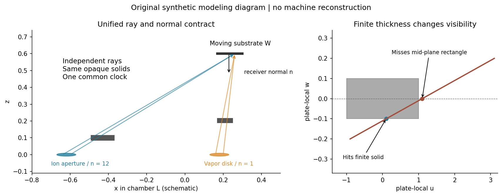

# 扩展源和有限厚板的双覆盖工程模型

## 本增补解决的问题

本轮把 T01 第二轮的公共坐标与时钟、T02 的有限源和实体求交、T05 的发射率归一化及 T10 的离子计量定义接到一个可复算的小模型。主结论是：接口可接通，解析与局部求交可校验，但某一方向的网格变化很小不能代表整套模型达到指定精度。有限源的半影和“离子有、蒸气完全无”的指示函数尤其不能由空间均值变化代替验收。

本报告只承诺四组固定合成研究，不声称用户机台、真实材料或真实离子束经过验证。所有尺寸、速度、粒子率、能量、密度及扰动值都是教学输入。以直接外啮合 D 为条件基线；C 复合轮系和 I 独立驱动的原图门槛仍 unsupported，适配器直接拒绝它们。没有在本轮追认结构，没有访问设备或运行用户工艺。

## 统一但不混同的合同

右手腔体坐标为 L，工件局部坐标为 W。角度以 rad，长度以 m，时间以 s。工件点 x_p(t)=c(t)+R_z(ψ(t))p，法向也乘同一旋转。φ 频率为 1/4 转每秒，固定太阳轮直接外啮合在无滑动理想条件下给 ψ 频率 (1+120/36)/4=13/12 转每秒。源和板均固定于 L；任意 CAD、随动板、轴倾和弹性误差不在这个实现中。

共同层窗为 [0,7.3] s，蒸气门 [0.55,6.55)，离子门 [0,7.3)。所有离散时间面板先在门控边界分段；不会用相互独立的时间原点悄悄移动一个通道。给定面板目标数后各门窗独立取 ceil，所以目标127/509/1531对应实际129/511/1533节点，不把面板数误报为实际节点数。

每个通道都有独立源：节点位置 s_cq、单位发射法向 n_cq、非负总发射率份额 f_cq，Σf=1。源率 Q_c(t) 的单位为该通道粒子每秒。源面积已经进入归一化节点权重，不能再乘一次面积。蒸气 Q 计原子，离子 Q 计正离子，不将质量率、安培和原子率混用。需要质量率时须另给粒子质量/组成，需要由电流推粒子率时须另给粒子数份额的电荷态。

当前适配器的蒸气盘姿态固定为+z，不是任意源姿态输入器；修改该假设必须另立版本并验证。主例蒸气为半径0.035 m、中心(0.20,-0.08,0)的均匀盘，发射指数1，Q_v=2×10¹⁹×0.6²×π原子/s。主例离子为半径0.045 m、中心(-0.62,0.04,0)的盘，法向(0.8,0,0.6)，局部u=(0.6,0,-0.8)、v=(0,1,0)，指数12，Q_i=5×10¹⁸离子/s。这是有限孔口的弹道窄瓣代理，不是 Kaufman 空间电荷、栅极、等离子体或电场求解器；指数12与源率没有标定依据。A回归组单独保留 T01 原有平行高斯离子束，不能与C的有限发射盘混称同一离子模型。

## 从发射角到法向通量

令 d=(x-s)/r，r=|x-s|，发射角余弦 μ_s=n_s·d，接收投影 μ_w=max(-n_w·d,0)。半球概率密度为

p_Ω(μ_s)=(n+1)/(2π) μ_s^n，当 μ_s>0；背半球为0。

由于 2π∫₀¹ (n+1)/(2π)μ^n dμ=1，Q确为遮挡前半球总粒子率。每个节点给法向通量

Γ_c=Q_c Σ_q f_cq p_Ω(μ_s) μ_w V_cq / r²。

这里 μ_w 只乘一次。杯面已读出的粒子面通量不能再投影；若杯法向与目标法向不同，需要回到明确的束场模型重建观测，不能把杯面读数当作不带面积基准的标量。零质量/零粒子权重节点在距离运算前删除，不能因一个不贡献的节点恰与目标重合而报奇异。有效节点重合则拒绝，源点奇异性不会被任意小数掩盖。

与点源的转换是明确的：n=1时 T02 单位总率核等于 μ_s μ_w/(πr²)，因此 A 使用 Q_v=πH_ref²Γ_ref 恰好恢复 T01 的参考幅值；不是给扩展源经验加一个任意修正系数。常用的源发射角、接收角与距离分离形式可见[Zhang和Cai 2013，式1](https://pmc.ncbi.nlm.nih.gov/articles/PMC3817662/)，但本轮的归一化、双通道和验证均为此处独立推导。

## 实体遮挡和有限厚度

每条通道射线是开线段 s+λ(x-s)，0<λ<1。板为矩形闭实体，中心m，正交局部轴u,v,w，半宽a,b，厚度d_m。先将两个线段端点变换到板局部系，再求三个 slab 的 λ 区间交集。只有交集与开线段相交才遮挡。多板取遮挡逻辑并集；一个粒子被两块重叠板拦截也只扣一次。

T02冻结实现使用绝对1e-14 m阈值处理近似平行分量；这是SI合成尺度的浮点约定，不是尺度无关的稳健几何证书。精确相切计遮挡，零厚板共面射线按不遮挡约定；厚度趋零在共面集合上不保证与零厚分支连续。主例没有依赖这类零测度路径，但D会保留压力例。作者教材[PBRT第4版6.1.2](https://www.pbr-book.org/4ed/Shapes/Basic_Shape_Interface)给出三slab区间及浮点误差处理，本文没有声称现有核已经实现其全部稳健策略。

板厚不只是把中面移动一个数值。射线可由侧面进入并从侧面退出，或在中面已越过边界但在下半部仍击中实体；只测中面或仅检查上、下表面的投影都可能漏挡。有限源还使不同源节点在板面有不同视差。半影必须对可见源通量积分，不能把点源阴影做无物理权重的模糊。

所有普通板同时对两通道不透明。软件共享的是几何求交函数，不能共享一个已算好的布尔遮挡数组，因为蒸气和离子的起点、方向、源尺寸和相位权重不同。主例两板厚度分别0.02/0.03 m；这些数值只是检验厚度效应的固定合成值，不是制造建议。

## 输出和观测

本轮假设蒸气留存1、再溅射0、净原子密度8×10²⁸ m⁻³，故 Γ_net=Γ_v。输出 N_net=∫Γ_netdt、法向厚度h=N_net/n_atom、正离子注量D=∫Γ_idt、入射动能面密度U=e∫EΓ_idt、R=D/N_net、ε=(U/e)/N_net，以及 τ=∫1(Γ_i>0且Γ_net=0)dt。固定E=100 eV。U是入射动能，不是吸收热量。

R/ε只在N_net>0定义；零或负净增长不伪装成0。若已知绝对误差预算δN/|N|≥0.1，则标病态，而不是继续报告小相对误差。代码的网格比较只能产生经验差，不自动产生严格δN；D组用明确外给δN展示这一分类。

面积节点采用u=r²/a²的Gauss求积与周向中点；边界和额外中心见证点的面积权重为0，但参加采样PV。比值统计如果存在无定义点，必须同时看 finite_area_fraction；删去无定义点后的条件均值不能宣称整个基片平均。当前主例有限面积占比为1。nonfinite_witness_count字段计全部无定义观测点，不仅指零权边界点。局部R的面积平均、全片总离子数/总净原子数和瞬时比的时间平均是不同量。
