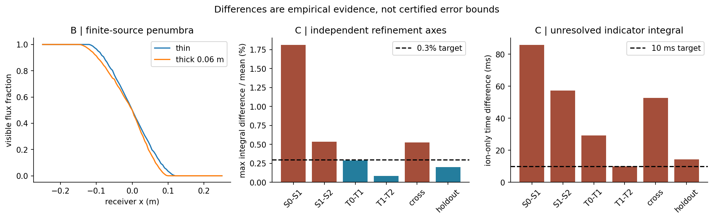

# 数值实现与误差证据

## 预登记与实现边界

[预登记协议](../verification/PRE_REGISTERED_PROTOCOL.md)在主模型和结果之前写入并做哈希。固定四组、固定三轴网格、150000000射线主预算、180秒单次墙时上限；一次独立窄复核另限3000000射线。达到有限检查清单或预算就停止，未达精度仍可冻结成 partial_numerical_acceptance，不追加优化搜索。

核心依赖只用 Python和NumPy；绘图用已存在的Matplotlib。T01运动/统计、T02有限源/实体、T05第二求积族、T10电荷常量均以原字节复制，哈希在data/frozen_dependencies.json；没有更改首轮文件或安装依赖。T03首轮正向算子的厚板并集与缓存限制作为接口约束阅读，本轮不复制或扩展优化器。

## A 点源和薄板回归

在13诊断点和三个已有薄板案例检查了幅值归一化与时间积分。相同瞬时节点对T01蒸气核的最大归一差≤4.84×10⁻¹⁶。1531目标面板与T01事件分段16点Gauss的主要积分最大差为：无板1.03×10⁻⁶、蒸气板0.00122242、离子板0.00207565，均低于0.003。最大独曝时间差3.678 ms。

A离子通量仍调用冻结T01核，所以这部分是接口回归，不是完全独立离子物理真值；独立性主要是新归一蒸气核与时间离散对事件分段。更完整的数学独立证据来自B解析和本轮另写求交算法，不以同源代码相等冒充独立验证。

## B 有限盘解析和半影

平面均匀半径a的cosine盘，总率Q，轴上接收点高度H、正对源，按面积平均可直接积分：

Γ=Q/(πa²)∫₀ᵃ [H²/(π(H²+r²)²)]2πr dr = Q/[π(H²+a²)]。

本例H=0.6、a=0.12、Q=1。16源节点相对误差6.57×10⁻⁸，未达预置1e-8；64和256节点误差降至9.14×10⁻¹⁶及1.31×10⁻¹⁶。失败的粗级保留。位于H/2且仅遮x≥0半源的薄板，在偶数对称角节点下通量恰为一半，差≤5.56×10⁻¹⁷。这是对称几何的精确特例，不证明任意半影网格均足够细。

零半径极限、零权节点重合、背向不发射、法向投影一次与重叠板不重复扣除另有单元测试。B的101点半影曲线只为建模图；本轮没有对曲线全点给连续域误差证书。

## C 三轴加密与交叉检查

源级S0/S1/S2分别为14/39/115节点每通道；时间级T0/T1/T2实际129/511/1533节点。空间级P0/P1/P2分别36/102/236点，其中有面积节点与零权边界见证点。主图为S1T1P2；同一13诊断点还算等面积中点源7×29=203节点/通道、T2时间作为留出。留出与最高Gauss源在相同T2比较是源求积族核查，不是第二个独立时间真值。

八角S0/S1×T0/T1×P0/P1全部运行，另做P2和六个诊断单轴/交叉组合，保留全部比较CSV。不同空间网格不插值成伪逐点差，只比较同一面积定义下的统计量；逐点时间/源比较用同一诊断点。

| 对照 | 主要积分最坏点差/参考诊断均值 | 独曝时长最大差 | 判断 |
|---|---:|---:|---|
| S0→S1，固定T1 | 1.812805% | 85.919 ms | 未达 |
| S1→S2，固定T1 | 0.535438% | 57.279 ms | 未达 |
| T0→T1，固定S1 | 0.288647% | 29.322 ms | 主要积分达目标，时长未达 |
| T1→T2，固定S1 | 0.085296% | 10.032 ms | 时长略超目标，不能四舍五入成通过 |
| S1T1→S2T2 | 0.525119% | 52.673 ms | 交叉未达 |
| S2T2→独立源求积族 | 0.202989% | 14.297 ms | 主要积分达目标，时长未达 |

P1→P2固定S1/T1的最大面积均值相对差0.000162898、CV绝对差0.000053728、采样PV绝对差0.000592374，全低于相应空间门槛。它们不能抵消源方向的未达：主图S1T1对诊断留出主要积分仍差0.384030%，超过0.3%。空间通过只适用于该固定数值核上的抽样统计；整个C未通过完整数值精度验收。

τ比总通量积分更难。有限源离散中，仅一个小权节点可见也会使“Γ>0”成立；增加源节点可在真半影边界附近延长很小通量的正支集。τ因此对源节点及浮点下溢比h/D更敏感。不能擅自把Γ>0改成某工艺阈值来获得通过；有物理剂量阈值的独曝定义是另一个需明确提出的观测量。

主图在未完整验收的S1T1P2离散上：h均值0.666633 nm、CV4.880899%；D均值2.040007×10¹⁹ m⁻²、CV0.595778%；U均值326.845 J/m²；局部积分R的面积均值0.383459。亚纳米连续厚度只是模型量，不证明形成完整连续实膜。

## D 假收敛和病态量

构造非负解析速率f(t)=1+0.8cos(2π×1016t)，t∈[0,1]。127和254中点网格都得到1.8，互差约10⁻¹⁵，但真积分为1。509非整倍数网格得到1.0000000000000069。两套同族欠采样恰好一致，仍有80%误差。因此本轮没有“连续两级相等即收敛”的判据。

取D=10¹⁸、N=10¹²，R=10⁶可以是有限数，却在δN=10¹²下没有有限比值误差界。若N=0，R无定义。若N_ref>δN且有真实绝对误差界，可推出

|R-R_ref|≤[δD+|R_ref|δN]/(N_ref-δN)。

本式是条件数学结论；网格差未经可靠性证明不能直接充当严格δ。D还覆盖有限实体侧壁、开线段端点、掠入射与薄板共面约定。独立复核报告应与单元测试一起阅读，不能据几千条随机射线宣布所有退化几何稳健。

## 为什么相同厚度不确定离子剂量

在本例留存1、再溅射0、密度固定的显式假设下，厚度只依赖蒸气。保持所有蒸气与运动参数不变，把离子总率×2，重新计算所得h逐点完全相同，D和U逐点精确×2，R和ε也×2。这是模型可辨识性的反例，不是声称真实离子辅助总可独立于增长：真实再溅射、密度、温度和化学变化可能让h也改变。

即使h发生耦合，厚度单图也不足以唯一确定源强、留存、密度和离子剂量；这需要独立诊断约束。把两块厚板都改为零厚，在13诊断点的主要积分最大差达15.084%，表明几何模型形式误差可以明显大于时间加密差；不能通过加密错误的中面遮挡核修复漏侧壁。
