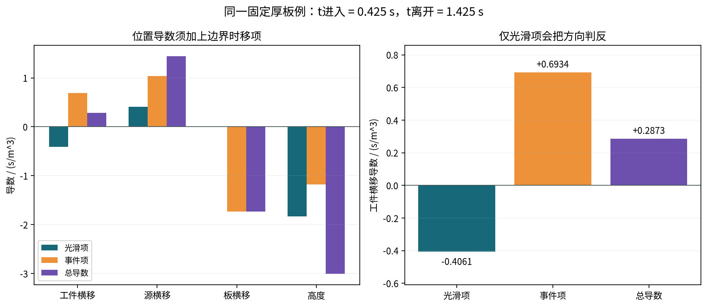

# T02第三轮 机械位姿与硬遮挡敏感度

T02-r3-v0.1.0，2026-10-02 UTC。**本地有界理论与接口冻结；连续源高算量及实机验证未执行，正式指定模型链pending。**

机械误差不仅改变距离和法向，也移动遮挡进入/离开时刻。新合成例中，工件横移的光滑项−0.4061与事件项+0.6934合成+0.2873；漏掉事件会把修正方向判反。相切、近合并、端点、活动面并列和几何unknown不发普通梯度。

## 阅读入口

直接打开[完整离线阅读版](reader.html)，无需服务器或联网。三张PNG已实际查看，HTML浏览器layout未验证。

1. [位姿链与光滑通量](reports/01_scope_and_pose_transport.md)
2. [事件导数及拓扑](reports/02_event_derivative_and_topology.md)
3. [有限厚板完整可复算例](reports/03_recomputable_affine_reference.md)
4. [不确定性 混淆及八类错误](reports/04_uncertainty_confounding_failure_cases.md)
5. [算法 driver和接口](reports/05_algorithm_driver_and_interfaces.md)
6. [证据与接受边界](reports/06_results_and_acceptance.md)
7. [五项主来源摘要](sources/research_notes.md)、[唯一窄核查](reviews/INDEPENDENT_REVIEW.md)、[修复重放](reviews/AUTHOR_FIXES_AND_REPLAY.md)
8. [T03第三轮候选](T03_ROUND3_HANDOFF.md)，未启动



## 已核验与未执行

- 31项小型unittest通过；一次独立12项检查初始11通过、1失败，oracle近合并门控已修复，作者定点重放通过
- 闭式原函数Dual与分段光滑导数加事件项一致；两条路径仍受同一限定物理假设约束
- 默认driver只打印完整计划，估计约59.03×10⁹次核求值；当前未恢复设备授权，不运行heavy
- 旧点12连续参考partial，点2条件包络非严格认证，tight未完成；本轮没有重算或升级旧资格
- 实测模板保留null并拒绝；不造日志、源率、时间基准或实机参数
- 读者ZIP不含第三方原文、账户/Library私有标识或原工程运行依赖，不上传

## 独立解压复算

Python3.10+，NumPy1.24–2.x。工作目录为本README所在目录；命令默认只读。

```sh
python -B verification/reader_check.py --check
python -B -m unittest discover -s verification -p 'test_small.py' -v
python -B models/run_examples.py
python -B models/offline_read.py data/synthetic_contract.json --allow-synthetic
python -B models/device_driver.py
python -B reviews/author_replay.py
```

图重建另需Matplotlib及Noto CJK字体；HTML重建需Pandoc，阅读和数值复算无需这些工具。`verification/reader_check.py --build`为作者生成清单/ZIP入口，不是验证已收文件的命令。

本地归档为deliverables/T02_round3_pose_occlusion_sensitivity_v0.1.0_reader.zip。固定允许列表、内容manifest与ZIP外receipt分别记录成员及hash；manifest排除自身，receipt不进入reader。完整性校验不是数字签名或实机资格。本轮停在local freeze，不自动下一题或上传。
