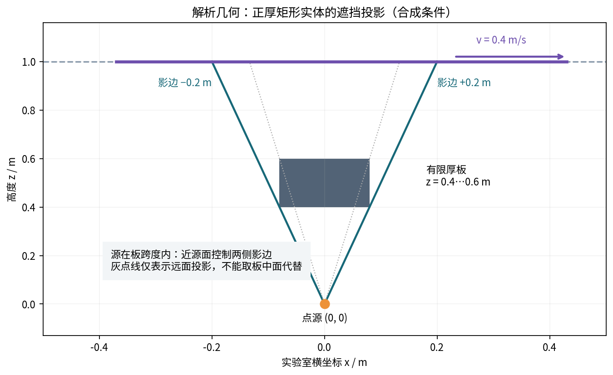

# 03 一个完整可复算的有限厚板事件族

## 1 几何和源合同

令源s=(s_x,0,0)，工件点x(t)=(x0+p_x+v(t+δt),0,H)，法向分别为源向上、工件向下。板盒体为x∈[b−a,b+a]、y∈[−h_y,h_y]、z∈[z0,z1]，0<z0<z1<H，a,h_y>0。所有射线位于y=0，因此不会越出y面。改变y、倾板或转动轨迹会超出此解析族，不能在这里套用。

这是有限厚实体，不是零厚度示意。当前合成基线H=1 m、z0=0.4 m、z1=0.6 m、a=0.08 m、x0=−0.4 m、p_x=0.03 m、v=0.4 m/s、t∈[0,2] s。大尺寸仅为算式好复核，没有任何本机尺寸含义。q=1+0.3t、A=1，正源率。

## 2 从射线投影导出所有事件

在板面高度z，射线横坐标为(1−z/H)s_x+(z/H)x_t。令它等于边界e=b±a，得到目标平面的投影位置

B(e,z)=s_x+(e−s_x)H/z。

射线扫过板厚区间时，只要存在z使其横坐标在板宽之内就被挡。由于投影区间随z连续且每个宽度为正，其并集是一个区间：

L=min[B(b−a,z0), B(b−a,z1)]

U=max[B(b+a,z0), B(b+a,z1)]。

这在本族中列出了全部可能的遮挡时段，没有扫点漏掉两个很近根的问题。s_x位于板横向跨度内部时，近源面z0控制两侧阴影；源横移到外侧后，一侧由远面z1控制。使用板中面会错估阴影与其导数。s_x恰好等于b±a时，相关near/far候选并列，该模型拒绝普通Jacobian，保留topology_switch_unresolved。

v≠0时两事件候选为t=(B−x0−p_x)/v−δt，按时间排序，再与[t0,t1]相交。v<0会交换进入/离开顺序。v=0时以静态名义可见性求积分，灵敏度门控不放行；非常小但非零v仍计算真实候选时刻，不能偷当完全静止。

## 3 七参数事件Jacobian

向量p=(p_x,s_shift,δt,A,b,a,H)，参数单位依次为m,m,s,1,m,m,m。对活动面z和边符号σ∈{−1,+1}：

B_p = [0, 1−H/z, 0, 0, H/z, σH/z, (b+σa−s_x)/z]

t_p = B_p/v − [1/v,0,1,0,0,0,0]。

本轮不把v列入参数。若未来加入v且x(t)=x0+p_x+v(t+δt)，则t_v=−(t+δt)/v，光滑通量也增加K_x(t+δt)。加入板z位置/厚度的导数会影响活动面z和事件分支，需独立处理，不能从a的导数冒名替代。

## 4 可解析的沉积积分

m=1、n_s向上、n向下时，y=x_t−s_x，核为

K=A(q0+q1t)H²/(H²+y²)²。

定义d=x0+p_x+vδt−s_x，使y=vt+d。两个原函数为

P0(y)= y/[2(H²+y²)] + atan(y/H)/(2H)

P1(y)= −H²/[2(H²+y²)]。

任意光滑时间段的积分由F(t)的上下限差给出：

F(t)=A/v{(q0−q1 d/v)P0(y)+(q1/v)P1(y)}。

因为dP0/dy=H²/(H²+y²)²，dP1/dy=yH²/(H²+y²)²，可直接逐项核验。v=0分支用固定几何核乘q的多项式积分，避免除零。小v时两原函数值的差可能出现消去，因此输出仅为普通浮点代数参考；不宣称跨极端参数仍达到固定相对精度。

`evaluate` 用该原函数求名义积分，光滑Jacobian用分段Gauss-Legendre积分，再显式加事件项。`analytic_oracle` 则用前向Dual对已选光滑分支的闭式原函数和端点求导，不经过任何布尔可见性。两条路径都共享模型假设，但代码计算路径不同；它们一致仍不等于实验验证或严格浮点证书。

## 5 基线可直接核对的数字

进入t_e=0.425 s，离开t_l=1.425 s。I=1.1023811408179522 s/m²。

| 参数 | 光滑项 | 事件项 | 总导数 |
|---|---:|---:|---:|
| 工件横移p_x | −0.4061427694 | +0.6934171598 | +0.2872743904 |
| 源横移 | +0.4061427694 | +1.0401257396 | +1.4462685090 |
| 运动时钟δt | −0.1624571078 | +0.2773668639 | +0.1149097562 |
| 源幅度A | +1.1023811408 | 0 | +1.1023811408 |
| 板横移b | 0 | −1.7335428994 | −1.7335428994 |
| 板半宽a | 0 | −14.7640070266 | −14.7640070266 |
| 工件高度H | −1.8285817634 | −1.1811205621 | −3.0097023256 |

导数的量纲为(s/m²)/对应参数单位；不能把时钟列与平移列按裸数值大小比较。第一行尤其关键：漏事件项会把横移方向判断反号。板半宽完全通过事件项影响积分，直接AD光滑核会错报零。

基线两条求导路径的最大绝对差1.78×10⁻¹⁵，仅为这组条件良好的浮点小例结果，不是给全模型设定的误差上界。

## 6 负例与可复算范围

单次小测试包括正负v、源位于板跨度之外的活动面变化、全遮挡、全可见、名义有理射线对照、近边界unknown、端点重合、面并列、低速度以及法向/位置联动。没有用真实日志，也没有重复前轮全盘、两个二维源、13点或236点计算。

重算入口均以当前包根为工作目录；没有 `../../` 运行时导入。图由这里的解析小例生成，不是测量截图。完整高算量线源计划是独立于小测试的未执行层，不会被默认测试命令触发。
