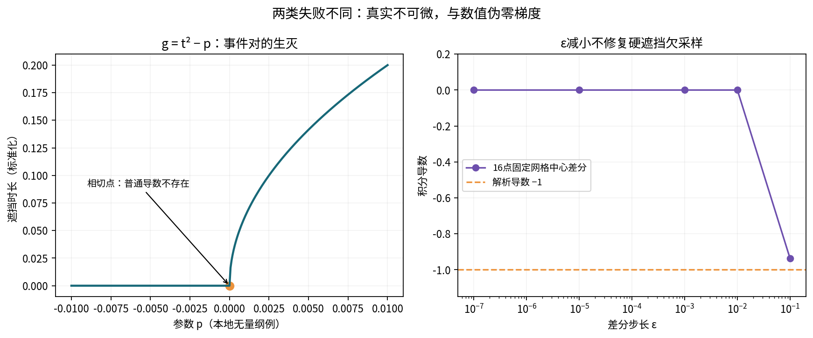

# 04 不确定性、混淆及错误案例

## 1 不确定边界与数值根误差必须拆开

本轮分别保留四类量：机械/几何输入不确定性；事件定位与浮点判定误差；时间/源/空间求积误差；模型失配。观测噪声是进入机械输入估计的另一层，不能再与估计后协方差重复相加。系统误差存在相关性时，也不能全用平方和当作独立随机项。

三态有理求交器的 `local_margin_m` 是板局部射线端点与边界误差的外部包络条件。它不是校准所得σ，也不是本例的 `shadow_boundary_uncertainty_m`。后者明确指**目标平面上两个阴影边界**各自可能偏移的m数。近面投影放大H/z0=2.5，故0.0004 m板横移会产生0.001 m目标阴影位移；直接把两种margin等同会低估误差。

若给定非负K，且两目标阴影边界误差各不超过η，对本例v≠0，事件时间半径ε=η/|v|。名义遮挡[a,b]外扩为[a−ε,b+ε]给透过积分下界；内缩[a+ε,b−ε]给上界，空内缩区间视为零遮挡。须与真实过程窗口求交。本例用原函数精确结构求值，但binary64并非外舍入，因此标签仍是conditional_nonnegative_flux_envelope_not_strict_certificate。

## 2 条件线性传播何时可以用

固定分支且残余非线性足够小时，δI≈J_p δp，Σ_I≈J_p Σ_p J_pᵀ。Σ_p必须包括时钟、机械、源等相关块。不能把每个参数的单轴曲线当作独立原因再拼平方和。

例如J=(1,−1)，输入协方差[[1,0.8],[0.8,1]]给方差0.4；忽略相关性会给2。若相关系数为−0.8，结果又变成3.6。相关性本身需数据支持，例子不是对本机误差的假设。代码检查对称半正定；状态不是differentiable_conditional时，不输出线性方差。

应先证明拟使用的参数邻域不越过活动面并列、事件端点/排序及角度边界。局部雅可比很小可能是项间相消，也可能是当前离散网格根本没看到事件；它不自动说明设计稳健。若不确定集跨多个事件分支，应该传播分支联合分布或集合包络，保存多峰与原子概率，不能只报均值±σ。

JCGM 101讨论通过模型传播联合输入分布，并给出其Monte Carlo结果有效性的条件。任意硬离散输出/不连续分布不能无条件套用其覆盖区间程序；本轮没有启动Monte Carlo或宣称满足标准中的全部适用条件。[JCGM 101:2008，5.10、7、8](https://www.bipm.org/documents/20126/2071204/JCGM_101_2008_E.pdf)

## 3 运动、源和时钟的可辨识性

### 3.1 恒速运动的相位—时钟零空间

本例x=x0+p_x+v(t+δt)，源率固定参考时间，因此J_clock=v J_target逐点严格成立，不只是积分偶然一致。只看这些厚度/遮挡事件，不能把p_x与δt分开。多工件相同v也不会自然补秩。需要独立同步事件、编码器时间标定，或带已知变化速度的额外观测；不允许从“优化结果看起来平滑”认定时间零点已经标定。

### 3.2 共移平移基准

同时把工件、源、板沿x平移同一δ，所有相对距离与遮挡不变。故J_target+J_source+J_plate=0。没有外部坐标基准时，这是几何gauge，不是优化器失败。先固定可靠基准，再估计相对参数；不要加一个强正则项后称三者都被数据独立识别。

### 3.3 幅度与时间/高度混淆

单一积分只给一个标量，七列梯度不会让七参数都可估。幅度A乘全量；恒定简化轴上核中高度H改变也可被源幅度吸收，T01已给出反例。有限板和非恒速率可能打破某些精确退化，但要用完整观测矩阵与干扰参数投影验证，不能只看局部一个非零偏导。

若把源率记录的时钟也平移，则I_δt增加q'(t)相关项；若过程起止时刻也随时钟移位，还会有端点项。三个问题不同：运动相位误差、源时序误差、积分窗口误差。接口必须分别命名和指定时钟映射。

## 4 八类常见错误与可证伪检查

| 错误做法 | 为什么错 | 本包的反例或处理 |
|---|---|---|
| 固定V后自动微分K，叫完整机械梯度 | 漏边界时刻移动 | 工件横移总导数与光滑项反号；板半宽光滑项为0 |
| 步长越小，finite difference一定越准 | 差分步长小于网格节点间距时遮挡样本不变 | 16点阶跃例，真实导数−1，ε≤0.01返回0 |
| complex-step能穿过硬遮挡 | 复数不等式、clip及bool不是解析映射 | 只在已经分段的光滑原函数使用合法求导 |
| 将unknown当clear | 可能凭空制造可见通量/曝光时长 | 有理判定拒绝bool；区间传播不填默认透过 |
| 对极小速度强制设为静止 | 很长过程仍会穿越板影 | 小但非零v保留两个事件，梯度暂不放行 |
| 用板中面求影子，再补厚度容差 | 活动近/远面与源位置共同决定投影 | 外侧源一侧近面、一侧远面 |
| 只看I收敛便接受曝光时长τ | τ取决于支集而非通量总量 | 很小假可见通量也能改变一段正时间的Γ>0 |
| 同一基线一致就给严格证书 | 路径可同错；浮点与连续源仍未认证 | oracle、三态谓词、独核分层保存，严格证书=false |

有限差分不是被禁止的数学工具。可在已证明同一分支、已精确分段的连续积分值上，作为独立诊断比较。若每次积分误差≤ε_I，则中心差分仅数值误差部分就可能达ε_I/δ；再加截断误差和拓扑换支，盲目减δ会更坏。应报告步长族、积分误差与分支状态，不能用一条相似曲线替代梯度可靠性论证。

## 5 unknown并非适用于所有目标的“保守小值”

对非负沉积通量，全部unknown按blocked产生下界，按clear产生上界。对均匀度CV、比值、损失函数、净再溅射或有正负权的统计量，这种单一替代不保证保守；分母可能接近零，最大/最小位置可能换点。优化器应接收区间或未决状态，自行按目标定义作安全排序。

机械输入区间会让事件时刻相关移动。把两个事件各自最坏时间独立拼接常产生较宽但条件安全的包络；若声称更窄，就需证明相关约束，而不能凭两个单轴扰动曲线外推所有组合。

## 6 与旧点2/点12的明确关系

点12离子源0.202989%源求积族差对应的连续base/tight参考未执行，本轮不重跑。点2的旧支集时间区间[1.362981129,1.363002586] s来自前轮条件包络；binary64三角函数、凸包和guard不是严格区间认证。点2 tight仍中断未完成。其源/时间残余资格不因新的事件推导或31个小测试而提高。
