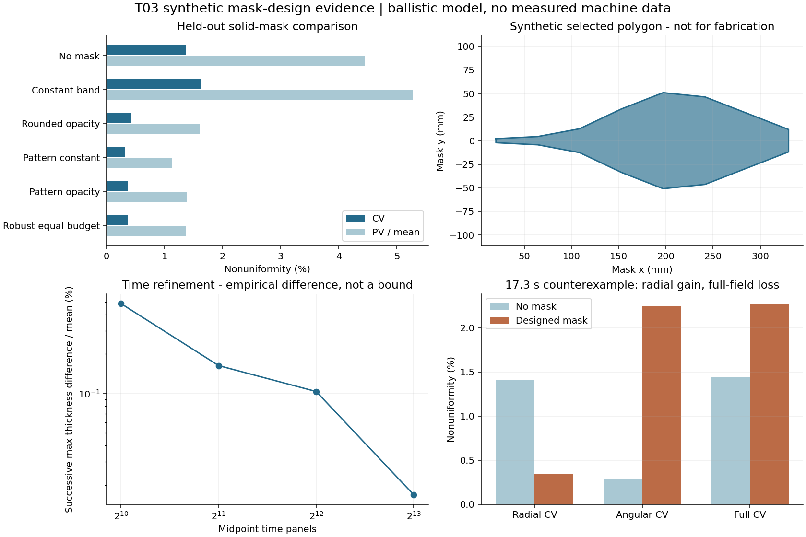

# 修正板合成数值研究结果

## 1 算例和选择规则

所有几何、材料和工艺参数均为合成设置。工件半径120 mm、公转半径220 mm、源到工件高度650 mm、源半径15 mm、源x偏置120 mm、板中面z=500 mm、验证实体厚度1 mm。公转15 rpm、平面绝对自转比3.7、源指数2、名义质量率10^-6 kg/s、有效密度3000 kg/m³、留存1。主算例持续40 s，速率恒定；这有利于周期覆盖，是明确案例条件，不是任意层时长的保证。

训练使用4×16=64个面积点、2048个中点时间节点、2×8=16个源节点。留出验证使用6×24=144个点、角向错开0.137 rad、4096时间节点、3×16=48源节点，并使用不剪枝的全射线实体求交。训练板形搜索用薄板近似，验证用真实1 mm厚度。

名义两种起点的选择只依据各自训练目标，验证数据不参与选优。两者预算上限都是480次；稳健方案3个情景，最多160次候选即480次情景调用上界。不得用验证表重新选择候选再宣称完全独立留出。

## 2 实体板对照

| 方法 | CV % | 径向CV % | 角向CV % | PV/mean % | 平均沉积保留 % |
|---|---:|---:|---:|---:|---:|
| 无板 | 1.3751 | 1.3751 | 0.0000 | 4.4417 | 100.000 |
| 常半宽25 mm板 | 1.6289 | 1.6207 | 0.1633 | 5.2775 | 93.500 |
| 灰度按列面积转换 | 0.4317 | 0.3872 | 0.1907 | 1.6090 | 90.742 |
| 常宽起点模式搜索 | 0.3203 | 0.2989 | 0.1151 | 1.1271 | 90.179 |
| 松弛起点模式搜索 | 0.3653 | 0.3455 | 0.1187 | 1.3896 | 89.476 |
| 三情景稳健搜索 | 0.3622 | 0.3415 | 0.1207 | 1.3733 | 89.598 |

选中常宽起点的模式搜索板：无板10.676738 nm，选中板9.628155 nm，η=0.901788。其1/η≈1.1089只是等均值时间倍率估计；真正延长层时间要重新积分。常宽基线的均匀性比无板更差，说明随意加板本身不保证改善。

## 3 灰度松弛不能与实体结果混称

灰度矩阵形状64×96，数值秩32。它是欠定且含弱可辨识方向的问题，不能直接求唯一几何逆解。凸求解在1696步达到投影梯度映射残差9.992e-09，吞吐违约为0.0。这不是严格对偶间隙或全局实体板证书。

灰度代理训练CV为0.0213%，同一灰度图在密集留出薄平面上的CV为0.0956%、PV/mean为0.4289%、保留比89.998%。留出比训练差，仍需防止对离散网格过拟合。实体板结果使用不同且受限的设计族，不能将灰度的更好数值当作已经可以制造的性能。

## 4 预算和耗时

| 方法 | 候选评价 | 情景评价上界 | 搜索秒数 | 停止原因 |
|---|---:|---:|---:|---|
| 常宽起点模式搜索 | 369 | 369 | 2.497 | step_floor |
| 松弛起点模式搜索 | 241 | 241 | 1.546 | step_floor |
| 三情景稳健搜索 | 145 | 435 | 2.504 | budget |

响应缓存构建0.457 s，灰度迭代0.084 s；多情景缓存额外开销未合并进单次搜索秒数。全部基准含密集验证与情景重算共195.2 s，Python 3.12.14、NumPy 2.3.5、BLAS线程1。墙钟时间依赖运行环境，仅为本次记录。停止时last_step可能是已减半的下一步，不代表这个更小步长已经全部试过。

## 5 分开检查三种离散误差

固定同一组工件点/源节点，只加密时间512→1024→2048→4096→8192；最后两级逐点厚度差的max/mean为0.01684%。固定工件点/4096时间节点，加密扩展源8→24→48→96节点；最后两级对应差为0.01041%。两者是不同控制变量实验，不能直接合并成严格总误差上界。

空间网格36→64→144→256点时，CV依次约0.3089%、0.3352%、0.3219%、0.3235%，均值趋于稳定，但PV/mean约0.8655%、1.0242%、1.1395%、1.2002%。更密网格找到了更极端位置，因此不能只用均值收敛宣称最差点收敛。这里空间加密固定24源节点，故与上表48源节点的144点值有小差异。

另外用8192时间节点和48源节点计算中心+96个外缘探针，相对主验证面积均值的最差偏差为0.7514%。这组探针不参与面积平均，也不是连续边缘的数学上界。完整数字见time_convergence.csv、source_convergence.csv、surface_convergence.csv与edge_probes.json。

## 6 稳健性研究的负结果

对源x±5 mm、板z±5 mm、指数±0.15、源半径增加5 mm及联合未见偏差，名义板的CV大致保持在0.326%–0.361%的范围。这是固定4×16点的情景表，不可与另一空间网格的主表逐位比较。层时长变38.7 s并改变初相位时，名义CV升至约0.797%，三情景稳健板约0.954%；后者未覆盖这种扰动，也没有在等评价预算下普遍更好。

全部已测情景中最低厚度保留比89.467%，均未触碰80%示例下限。但不能把这解释为对所有扰动均满足约束。名义板全边收缩0.25 mm后，最窄半宽从2.125 mm降为1.875 mm，低于2 mm几何下限；这项几何失败已在CSV标False。真实制造必须给约束留裕量，不能只看膜厚曲线。

## 7 明确失败案例

将层时长改为17.3 s，并加入8%的源速率正弦波动后，同一算法族重新优化得到的实体候选：径向CV从1.410%降到0.349%，但角向CV从0.287%升到2.241%，全场CV从1.439%升到2.268%，PV/mean从5.239%升到10.587%。该候选应拒绝，不能用径向好转掩盖二维恶化。

目标包含90%厚度比项，有限时长的角向纹理和目标权重可使目标函数下降而CV变坏。工程验收应分别检查硬指标，并允许无板回退。还提供奇异矩阵和要求厚度超过无板上限的不可达目标反例，提示更复杂优化器不能消除物理不可行性。

## 8 图示和证据边界

图中蓝色比较来自明确合成主算例，橙色为失败反例；板多边形以mm显示，但导出的原始顶点为m。全部结果可由脚本复算。47项硬断言涵盖单位缩放、遮挡、凸投影、厚板缓存回归和块方程等；它们验证实现与规定数学的一致性，未提供用户设备物理验证。
