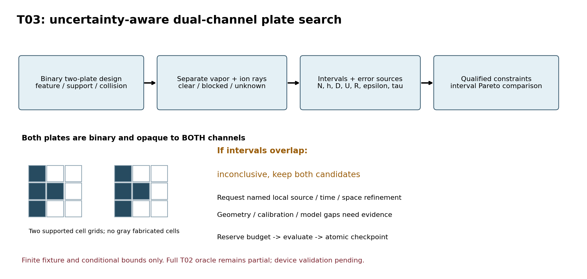
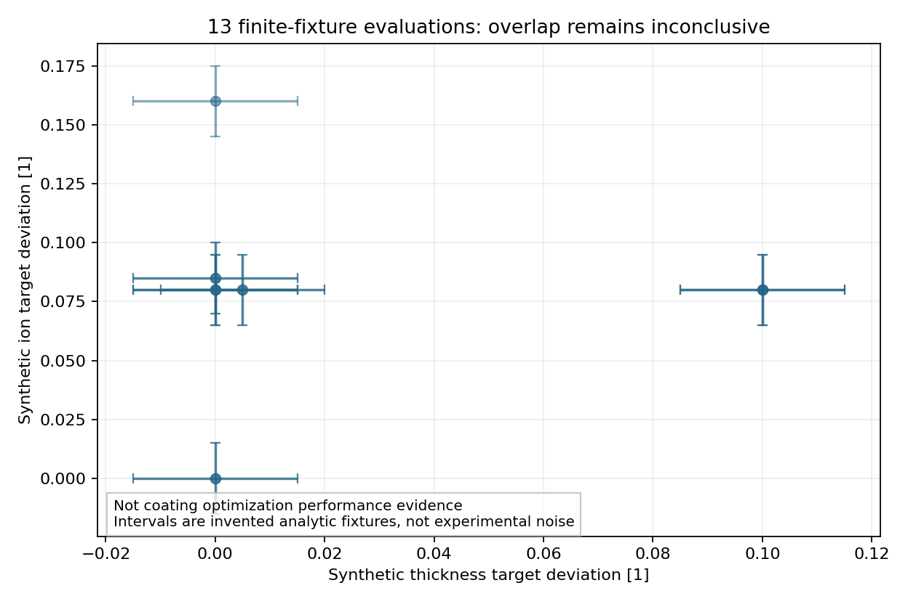

# T03 第二轮：误差感知双覆盖修正板优化

2026-10-02 UTC。**implementation_ready_validation_pending**。本地实现与小核验证已交付；完整正向oracle、设备高算量验证、真实性能、实机制造资格和指定正式审查均未完成。不push、不自动上传、不改产品沉积程序。

## 结论

- 双板均为有限厚、0/1 opaque实体，蒸气/离子各追各的射线，允许板厚/位置/catalog与二进制形状提案；检查feature、支承、边界、workspace、材料量、两板包络冲突
- 目标同时最小化厚度与离子注量或每净沉积原子能量的目标偏差；吞吐、h偏差、离子允许区间、可选独曝时长可作硬约束
- 仅相关决策量具有 `bounded_conditional` 资格才可认证条件可行/区间支配；`estimated`和`unknown`不升级。区间重叠输出 `inconclusive`，保留候选并提出具体误差轴、点/时间位置的加密请求
- T02 v0.3仍partial：点12离子连续参考未完成，点2事件带只是条件数值包络。旧经验网格差不会变成严格界。这里的有限射线oracle不是完整连续T02 oracle
- 40项主小测试 + 15项独立窄回归通过。纯合成演示15候选、13评价、2个制造拒绝，结果inconclusive；8-ray点源几何/文件协议smoke只验证接线。**这些不是优化性能证明**
- 三档设备计划共 **2,100,409,824** 名义射线，全部not_run。按点分块保持完整source/time，不为云端测试降低高保真方案。无GPU运行/加速比声明

## 文件导览

1. [算法规格和比较语义](reports/01_algorithm_spec_and_decision_semantics.md)
2. [设备验证计划与T04建议](reports/02_device_validation_plan.md)
3. [API、执行协议、结果字段](reports/03_interfaces_execution_and_results.md)
4. [本次证据与明确未达项](reports/04_implementation_evidence_and_limits.md)
5. [独立窄复核](reviews/independent_optimizer_review.md)、[来源卡片](sources/source_cards.md)
6. [阶段状态](optimizer_stage.json)、[精确允许列表](verification/public_allowlist.txt)、[完整性清单](verification/reader_manifest.json)




## 复现

Python 3.10+；运行算法与测试仅标准库。绘图另需Matplotlib。以本目录为cwd：

```sh
python -B -m unittest discover -s verification -p 'test_small.py' -v
python -B -m unittest discover -s reviews -p 'test_optimizer_counterexamples.py' -v
python -B models/run_optimizer.py          # 默认仅计划
python -B models/device_runner.py          # 默认仅计划，不生成/读大束
python -B verification/reader_check.py --check --reader
```

显式执行仅小fixture：

```sh
python -B models/run_optimizer.py --execute --output /tmp/t03-fixture
python -B models/device_runner.py --config verification/small_device_contract.json --execute --input-root data --output /tmp/t03-device-smoke
```

恢复用相同配置、代码/数据版本和 `--resume`；取消由 `--cancel-file <path>` 指定文件的存在触发。执行高保真时须补齐输入真实SHA与 `device_ready`，显式 `--execute`。局部线程并行另需 `--workers 2 --allow-parallel`，最多4；本次未用多进程或高算量并行。没有对远程设备的自动提交。

只允许本目录清单文件进入后续集中发布。原始资料合法local-only，未下载或附第三方原文；无ZIP、cache/checkpoint、生产数据和未运行的大输出。所有前轮/T02文件保留。隔离reader只复制允许列表，不依赖父目录或产品程序。
