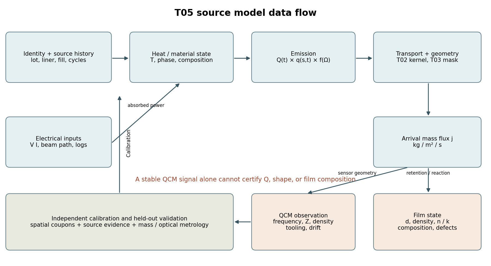

# T05 蒸发源特性与材料耦合建模

首轮v0.1的优先范围已形成研究冻结包：电阻蒸发与电子束蒸发的结构/热历史、归一化角通量、有限源与扫束、十二材料耦合、标定和失效边界。51项数值检查通过；没有用户机台实测或生产设置。

## 核心结论

- 总质量率Q、发射足迹q、角律f和接收投影必须分开；QCM nm/s不能直接输入kg/s模型
- 一个合成圆盘源被错拟合为点源时，近轴训练最大误差仅0.023%，大角留出可达191%；训练吻合不能证明源模型可外推
- 合成源在轴上QCM完全稳定时，45°位置通量可减半；源形改变必须更新T03修正板影响算子
- 十二材料全部保留条件化源/容器候选；Cr升华、H4牌号、MgF2相容性冲突、氧化物放氧和氟化物解离不能统一成一套源常数

## 阅读顺序

1. [物理量与归一化](reports/01_source_physics_and_normalization.md)
2. [电阻源与热历史](reports/02_resistance_sources_and_thermal_history.md)
3. [电子束与扫束](reports/03_electron_beam_sources_and_sweep.md)
4. [十二材料源耦合](reports/04_material_source_coupling.md)
5. [标定 可辨识性与接口](reports/05_calibration_identifiability_and_interfaces.md)
6. [数值结果与复现](reports/06_numerical_results_and_reproduction.md)
7. [安全 失效与证据限制](reports/07_safety_failure_modes_and_evidence_limits.md)

原创数据流图。热输入、发射质量、几何输运、传感器观测和膜状态分开；有效模型由独立数据和留出检验约束。

## 快速复现

从研究库根目录：

    PYTHONDONTWRITEBYTECODE=1 OPENBLAS_NUM_THREADS=1 python 05_evaporation_sources/tests/test_source_reference.py
    PYTHONDONTWRITEBYTECODE=1 OPENBLAS_NUM_THREADS=1 python 05_evaporation_sources/benchmarks/run_benchmarks.py
    PYTHONDONTWRITEBYTECODE=1 python 05_evaporation_sources/tests/check_release.py

核心只依赖已有NumPy。三图由benchmarks/plot_results.py可选重建；模型测试对T02有一个只读互操作检查。原文不附读者包时check_release.py使用--reader。

## 证据与阶段状态

[27条来源登记](sources/source_registry.json)、[逐条原创摘要](sources/summaries)、[12材料机器可读矩阵](data/material_source_matrix.json)、[实机测量模板](data/measurement_template.json)、[合成基准结果](benchmarks/results/benchmark_summary.json)均可复用。1份明确开放许可原文在本地排除目录保存；厂家手册和权利不明全文只保留链接与摘要。

[阶段范围验收](reviews/ROUND1_ACCEPTANCE.md)和[实际独立窄审](reviews/independent_source_physics_check.md)区分理论/合成/实测证据。指定DeepSeek、Seed与完整Sol审查链未实际运行的部分保持pending，不能称形式阶段通过。当前冻结是有界优先资料与参考模型交付，生产验证未执行。

下一步按原文进入[T06光学薄膜类型研究](T06_HANDOFF.md)。其他源型、热PDE/碰撞求解和实机闭环留到全部十专题首轮后再扩展。
