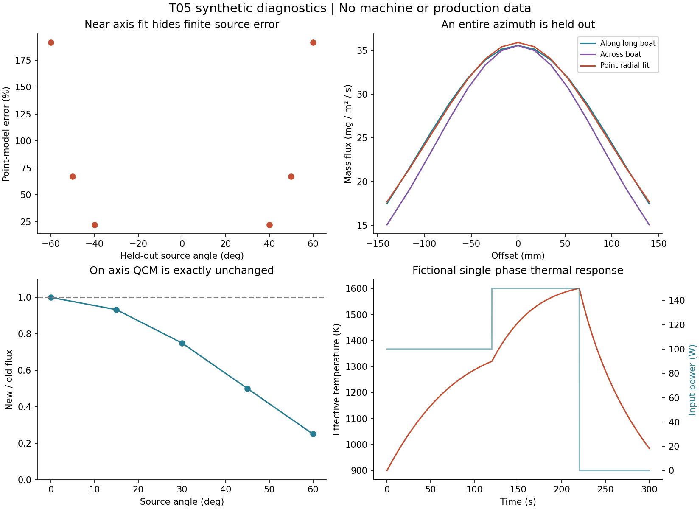

# 数值验证结果与复现

版本T05-reference-0.1，2026-10-02。全部输入是合成或解析基准，没有用户机台数据。核心只需Python 3与已有NumPy；可选绘图用已有Matplotlib。所有源率为kg/s，长度m，输出kg m⁻² s⁻¹；只有标明密度/留存条件后才能换算物理厚度。

## 1 实际执行的检查

51项单元/不变量检查通过，覆盖角分布积分、n=0背面门控、Lambert极限、正权重、圆盘轴上解析解、反平方、总率线性、接收面方向、遮挡、源/接收节点重合、输入NaN/越界、口沿逃逸质量、热质量账、离散能量账、耗尽、温区限制、热参数一致性、拟合退化、边界拟合和与T02同节点核的一致性。

独立窄范围审查发现并修复两项边界问题：零质量节点与接收点重合时不应触发物理奇点；n约束边界处不应仍给普通卡方自由度。修复后测试从41增至51并重新执行基准。热模型同时新增L_v=ΔH/M的一致性校验和压力溢出拒绝。见[审查记录](../reviews/independent_source_physics_check.md)。这次复核不是未实际运行的Seed/完整Sol阶段签署。

## 2 三种角向留出研究

| 情景 | 拟合数据 | 独立留出 | 实际结果 | 说明 |
|---|---|---|---|---|
| 正确点源模型+1%对数噪声 | ±5,15,25,35°共8点 | ±40,50,60° | 留出RMS 0.944%，最大1.322% | Q真值4×10⁻⁶，n真值2.5；拟合n=2.51981 |
| 有限圆盘被错当点源 | H=0.2 m，a=0.1 m，±12°内9点 | ±40,50,60° | 训练最大0.02295%；留出最大191.302% | “近轴拟合很好”是错误可信度来源 |
| 长方舟被错当轴对称点源 | 0.16×0.025 m源；沿长边截面 | 整个垂直方位截面 | 训练最大1.215%；留出最大17.412% | 径向截面不能验证二维对称性 |

这些百分数的分母都是各测点真实通量，不是峰值；远离源轴时真值更小，因此相对误差更大。基准同时存绝对通量，便于按真实产品权重重算。不能把这些特选失败幅度解释为普通设备的典型误差。

图1由本库代码生成。左上为有限圆盘点源误配的角向留出，右上为长方舟方位留出，左下为晶控盲区，右下为虚构单相材料热响应。

## 3 可辨识性与统计不确定度

同为8点、1%独立对数噪声，宽角布局n条件标准误0.04724；±3°窄角布局为6.89139。轴上两点即使距离不同，也由于秩亏被明确拒绝。若窄角误差足以触及n≥0边界，普通高斯近似本身也不可靠，不能机械套标准误当置信限。

400次合成噪声重复中，lnQ与n的95%边际区间覆盖率分别95.25%和95.5%，样本标准差为0.01032与0.04671。覆盖仅针对正确点源模型、已知几何、独立对数噪声，不包含任何实机物理缺项。

源高度错±2 mm（名义H=0.5 m）的无噪声敏感性使拟合n偏移约−0.03577/+0.03610，和本例1%测量噪声下的n标准误量级相当。这是确定性几何情景，不是带概率权重的统计分布。拟合软件给出的高置信度不能消除未计入的系统偏差。

## 4 晶控稳定与源形漂移

固定点源，n由1变3，同时Q由4×10⁻⁶降为2×10⁻⁶ kg/s，使Q(n+1)不变。轴上QCM完全不变；15、30、45、60°处的通量比为0.9330、0.75、0.5、0.25。这个解析可复算例不要求真实设备恰发生该变化；它证明仅一个观测量不能排除这种变化。

## 5 扫束相关与质量加权

合成Gaussian发射足迹重心和Q同相变化，固定接收面下若分别平均Q与w，最大通量误差9.3058%；正确以Q加权源形时误差约9×10⁻¹⁴%。加入静态半平面口沿/遮挡的例子，独立平均最大绝对误差是真实峰值的17.239%。该项采用峰值分母以避免暗区近零的相对值爆炸，与第2节指标不可混写。

正确质量加权恒等式只在K不随时间改变时成立。当前基准未实现行星运动与扫束的全耦合；它是给T02/T03接口的必要反例，不声称已完成实际行星盘验证。

## 6 热历史与质量账

虚构单相材料，显式Euler dt=0.1 s、共300 s，峰温1600.814 K，蒸发质量1.28053×10⁻⁴ kg。整体质量账绝对误差约2.35×10⁻¹⁷ kg；每步离散能量残差最大约9.09×10⁻¹³ J。与dt=0.05 s相比，最大温差0.11573 K，累计蒸发质量相对差0.02267%。

小残差说明实现按同一离散方程记账，不能证明热模型真实。该模型没有熔化潜热、流动、容器渐变、局部热点或解离；参数文件明确是fictional。真实单相近似若也不成立，应改模型而不是把dt无限减小。

## 6.1 源面积与口沿求积加密

另执行run_resolution_study.py。圆盘基准64×128节点相对256×256参考最大差0.000503%；长舟96×16相对384×64最大差0.001856%，远小于角向/方位模型误配。圆口遮挡的非光滑边界不单调收敛：20×80、40×160、80×320、160×640的正通量点最大相对差分别0.310%、0.711%、0.0783%、0.0498%，参考为320×640。粗网格突然“更好”可能是边缘采样巧合，不能仅比较两档就宣称收敛。口沿算例只作敏感性示范；更细参考仍有残余数值误差。

## 7 可复现命令

从研究库根目录运行：

    PYTHONDONTWRITEBYTECODE=1 OPENBLAS_NUM_THREADS=1 python 05_evaporation_sources/tests/test_source_reference.py
    PYTHONDONTWRITEBYTECODE=1 OPENBLAS_NUM_THREADS=1 python 05_evaporation_sources/benchmarks/run_benchmarks.py
    PYTHONDONTWRITEBYTECODE=1 OPENBLAS_NUM_THREADS=1 python 05_evaporation_sources/benchmarks/run_resolution_study.py
    MPLCONFIGDIR=/tmp/t05_matplotlib XDG_CACHE_HOME=/tmp/t05_cache python 05_evaporation_sources/benchmarks/plot_results.py
    PYTHONDONTWRITEBYTECODE=1 python 05_evaporation_sources/tests/check_release.py

读者包不附原文文件时，完整性检查追加--reader，仅跳过本地原文哈希，不跳过模型/数据验证。源码、结果JSON与CSV是主证据；PNG/SVG是原创阅读辅助。绘图不需要联网。

## 8 文件与运行范围

- models/source_reference.py：点/圆盘/长方源、非负Gaussian足迹、质量核、简化圆口、两参数对数拟合、局部热力学/集总动态
- tests/test_source_reference.py：51项已执行检查，含T02只读依赖；T02缺失时不能声称该项通过
- benchmarks/run_benchmarks.py：固定种子20261002，生成7个CSV与一个汇总JSON，另有加密研究JSON
- data/source_state.schema.json与synthetic_source_snapshot.json：SI源快照接口；额外物理不变量由代码验证
- data/measurement_template.json与CSV：未填实机模板，空值是未知，不是0
- figures：3个原创图，各有PNG与SVG

代码没有PID闭环、带电粒子场偏转、反应化学、DSMC、动态自由表面、真实相变或自动辨识完整源温场。本轮有界目标完成后交T06，不将这些缺项包装成已经实现。
