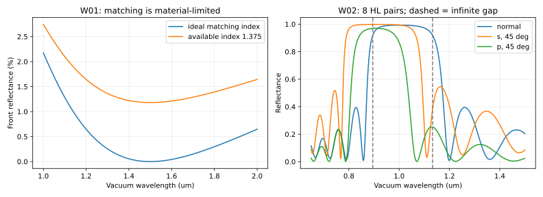
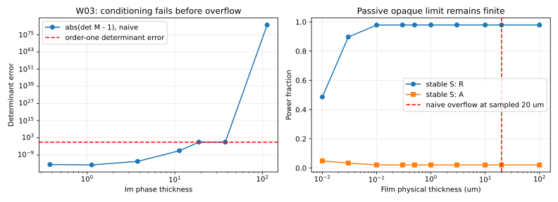
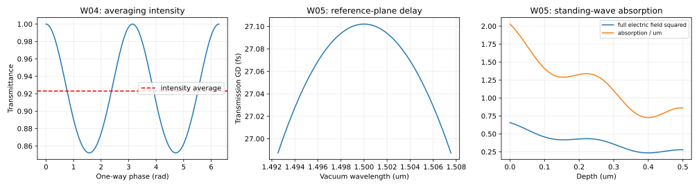
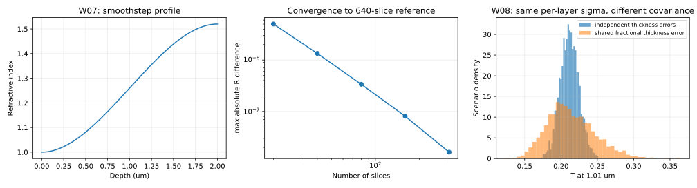

# 09 · 算例、复算步骤与结果判读

## 9.1 本轮数值包的用途

本核只有NumPy，图形生成另用Matplotlib。它独立实现S星积、直接特征矩阵、标量Airy递归、稳定内场和一个受限非相干强度组合。没有导入外部光学库或商品软件，也未修改T06代码。独立方法之间的一致性是计算正确性的证据，不是实际材料/设备真实性的证据。

从研究库根目录运行：

```bash
PYTHONDONTWRITEBYTECODE=1 python -m unittest discover -s 07_thin_film_design_theory/tests -v
PYTHONDONTWRITEBYTECODE=1 python 07_thin_film_design_theory/models/run_examples.py
PYTHONDONTWRITEBYTECODE=1 python 07_thin_film_design_theory/models/check_package.py
```

记录的运行环境为Python3.12.14、NumPy2.3.5、Matplotlib3.10.8。无网络运行即可复算。所需T06文件的SHA256保存在[data/t06_dependency_manifest.json](../data/t06_dependency_manifest.json)；纯理论W01–W08不依赖外部下载原文。结果完整机器数据在[example_results.json](../data/example_results.json)，便读指标在[自动表](09a_generated_results.md)。

## 9.2 八组算例的输入和检查逻辑

| 算例 | 主要输入 | 要检验的理论 | 数值/解析判据 |
|---|---|---|---|
| W01 单层AR | 空气/理想n或1.375/ns1.52；λ0=1.5µm | 导纳倒置与材料限制 | 理想R≈0；可得n场景R≈1.180868% |
| W02 周期镜 | 空气/(2.1,1.45)^8/ns1.52，λ0=1µm | 中心R、Bloch带边、角偏振 | R0≈0.993000423；无限带边处有限R≈0.919025 |
| W03 数值病态 | 空气/(0.2+6i,d)/1.5，λ=1µm，d至100µm | 衰减分支、S稳定性、TMM溢出 | 厚层R→0.978632479；A→0.021367521 |
| W04 相位平均 | 空气/n1.5/空气，均匀相位集 | 相干/非相干和平均顺序 | 〈T〉=12/13；|〈t〉|²≈0 |
| W05 腔/吸收 | n1.5、5µm平板；另2+0.15i、0.5µm层 | GD符号；p纵向场与吸收 | GD≈27.10208fs；吸收积分≈通量差 |
| W06 等效层 | H/2 L H/2，λ0=1µm | A=D、复等效参数和分支 | 5个λ重构误差<2×10⁻¹³ |
| W07 渐变剖面 | 2µm smoothstep，n1→1.52 | 分片收敛 | 20到320片对640片误差递减 |
| W08 灵敏度 | 17层合成腔；0.1%厚度σ | 协方差、一阶局限 | MC与JΣJ^T接近；共同/独立差异明确 |

这些输入中的常数n/k是明确的理论设定，不应被写回T04材料数据库。无色散方程在所有长度同比缩放下谱形有尺度不变性，但真实NIR/MWIR/LWIR材料有色散/吸收，不能凭这个缩放把1µm的理想栈称为10µm产品。

## 9.3 原创图与阅读顺序



图1左：W01使用理想匹配折射率和假设可用折射率的差异。右：W02有限8对镜的角/偏振响应；虚线是无限周期解析带边，不是99%阈值。



图2左：特征矩阵det失真先于溢出；超出有限浮点范围的点不伪绘为有限误差。右：S法在同一组厚度保持有限R/A。直接M有时在det失真后仍算出接近的R，这不构成内场或所有输出都可靠的证明。



图3：相位平均与相干纹波、腔传输群延迟、p偏振吸收层内场/吸收密度。E²以入射切向电场平方归一化，吸收密度单位为µm⁻¹；它们不是同一个物理量。



图4：原创smoothstep剖面、分片收敛、两种同逐层σ但不同协方差的统计情景。直方图不是生产数据。

## 9.4 冻结T06对照的范围

读取T06的material_proxies.json、starter_stacks.json及reference_tmm.py。对六个案例分别取151个λ点，在其声明AOI和s/p组合上比较前膜复r与T，共28组。最大复r绝对差约7.46×10⁻¹⁵、最大T绝对差约1.69×10⁻¹⁴。不是T06整片相干/非相干响应的全面复验；不改变其材料模型与波段边界。

E01用于单层AR匹配；E02用于非四分之一波两层；E03保留双谷不足以覆盖双带的反例；E04用于HL高反/终止层；E05用于单腔与相位；E06用于吸收金属边界。T06拒绝的厚强吸收情形由本册独立W03扩展，不篡改旧核的保护门槛。

## 9.5 测试覆盖与还没有测试的事

单元测试包括裸界面解析值、Brewster、TIR及受抑全反射、零厚/同介质/拆分层、AR与QW镜、无损周期带边、等效层重构、同β反向互易、功率归一化S被动性、吸收出射端口、逐层吸收积分、80组随机三算法对照、100µm强吸收层、1200对无损深禁带栈、S结合性、相位平均和GD网格收敛，以及非法输入。最终执行数量与输出见[测试日志](../reviews/test_output.txt)。

未做：真实n/k拟合与不确定度反演、散射/粗糙界面实验、各向异性4×4、强吸收入射半空间、通用部分相干、任意多层混合相干、超低T对数跟踪、自动精度认证、设备闭环或环境/损伤实验。这样的边界比声称“支持所有膜系”更可复用。

## 9.6 纠错记录与复算负例

1. S04 v1 Eq.30的整体比例与Eq.22不一致。n0=1.3、ns=1.7时常规切向t=0.8666667，而其Eq.32给0.6666667；与其Eq.34成对却得到正确T。这说明只测功率可能漏掉振幅归一化错误。独立报告见[MATH_SPOT_CHECK](../reviews/MATH_SPOT_CHECK.md)
2. S18可见GD多项式缺少由其相位多项式导出的线性项。本册不据此指控软件实现，而是要求自己微分和检测约定
3. 初次T06测试读错JSON的materials字典为列表，已改为按ID映射并重测；这不是光学方程失败
4. 初次W03诊断使用通用复数abs对已经溢出的det计算引发异常，改为hypot记录inf；不修改或裁剪物理R/T掩盖病态。最终示例可完整运行
5. 独立数学抽查的Γ定位和禁带上下边余弦符号曾各有一处表述问题，已复核更正；最终结果保留明确Eq.11与±边界

## 9.7 本轮停止条件

九章理论覆盖、关键公式单位/约定/条件、八组可复算例、来源边界、数值失败例、独立窄数学核查和T08接口均完成，即可把公开理论首轮交给协调者。商业全文缺失与真实设备验证另列，不用无限资料搜索阻塞后续专题。推进不等于生产验收，也不等于把待执行审查写成通过。
