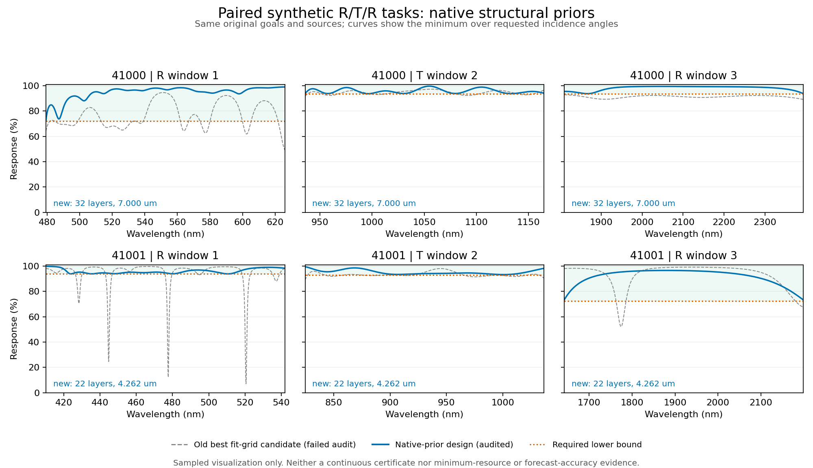

# 带通离线参考生成：配对实验报告

日期：2026-11-01。此报告属于快速层数／厚度预估的离线研究，不是软件功能发布，也不是预测模型准确率报告。

## 结论

在同一组 12 个合成任务（2 个材料组 × 6 个任务族）上，只改变带通任务的初始结构生成方式，有限预算内得到独立审计通过的参考设计由 10/12 增为 12/12。两项带通原先结果为未知，而非被证明不可行。其余十项所选设计的物理哈希、层数、总厚度完全一致。

- train-41000-bandpass：32 层，总厚度 6999.908042 nm。
- train-41001-bandpass：22 层，总厚度 4261.705893 nm。

这些数字是已找到的达标设计资源，不是最小层数／厚度，也不是快速预估输出。两个材料组不足以证明广泛兼容性。

## 对照条件

核心软件固定为 131d3fc989c3dc9ac8d94fee3c39541a61b851df。逐项确认原始 request 完全一致，保留材料色散与吸收、基片、目标、平均／逐点语义、严格比较、角度与偏振。配对键使用 case_id 和原始 request 的规范 JSON SHA256（沿用 artifact_store.canonical_json：UTF-8、键排序、紧凑分隔、ensure_ascii=False、拒绝非有限数值，末尾含一个换行），不能使用新增种子包后变化的完整任务哈希。

v3 使用周期／修饰周期／确定性随机起点；v4a 在两项带通任务中使用现有核心的多波段高反与带通结构生成器，按层数取有限代表起点，最多 8 个。生成器仅提出结构，不直接把候选标为达标。候选仍经局部修复、原指标独立审计和成对资源选择。

两边相同：41 点拟合网格、每次最多 60 次局部函数评价、45 秒协作式单任务修复预算、32 倍审计采样、两轮减量。45 秒不是强制终止的硬实时承诺。新增起点预处理另计，因此不能声称总耗时严格相同。停止逻辑按优化端点成功的层数桶计数；提前保存的合格初始候选即使端点失败仍保留，但不增加此计数。

## 失败诊断与曲线

对旧版两项失败任务，事后选择拟合网格上最大归一化误差最小的候选，再按原指标重新审计。它们仍失败；这只是训练诊断，不修改原基线，不是盲测。

- 41000：旧候选 32 层，拟合误差约 0.82581，重审最大归一化误差约 0.82581。
- 41001：旧候选 32 层，拟合误差约 0.77869，重审约 13.85923，反映较稀拟合网格可能遗漏窄违规谷。以上均为归一化误差，不是百分数。

曲线使用固定核心前向模型，每窗口 4097 个波长点并加入已记录审计极值位置，计算全部规定角度及偏振，展示角度间最差值。只绘制目标窗口，没有填补未约束间隙。CSV 保留实际计算数据。六个窗口中新设计的采样最小值均满足原下限；最紧的 41000 透射窗口余量约 0.00011545，即 0.011545 个百分点，不能解释为具备制造容差。有限采样不是连续全波段数学证明。

## 可重复性与证据

v3 全量结果提交：940018b05b76a06299d95f6507f33cb589aeedd7。v4a 全量结果提交：5f8e2d7bdb382a7a2ebe47200b2afb5653f60158。两套输入、源码、审计与见证已从远端独立恢复核验；v4a 12 项所选设计重新审计通过，保留 66 个见证文件。

本目录包含逐项配对 JSON／CSV、旧候选重审记录、诊断和绘图脚本、曲线数据与绘图检查。原始实验目录保持冻结。

## 对快速预估算法的意义与下一阶段边界

本实验说明参考样本生成的失败可能来自起点不合适，不能把有限搜索失败当作资源需求下界或不可行标签。它不提供层数／厚度回归误差、区间覆盖率或线上延迟的证据。

下一阶段必须单独冻结特征和预测模型协议，按材料组划分训练／校准／测试，扩大独立目标几何和材料组合，而不是把这 12 项重复当新样本。在线路径只允许材料与目标特征计算、固定公式／查表／轻量模型预测，不能调用这里的合成或局部优化；无校准支持的范围应明确标注。实际多光谱用户任务及近邻应保持外部验证用途。
