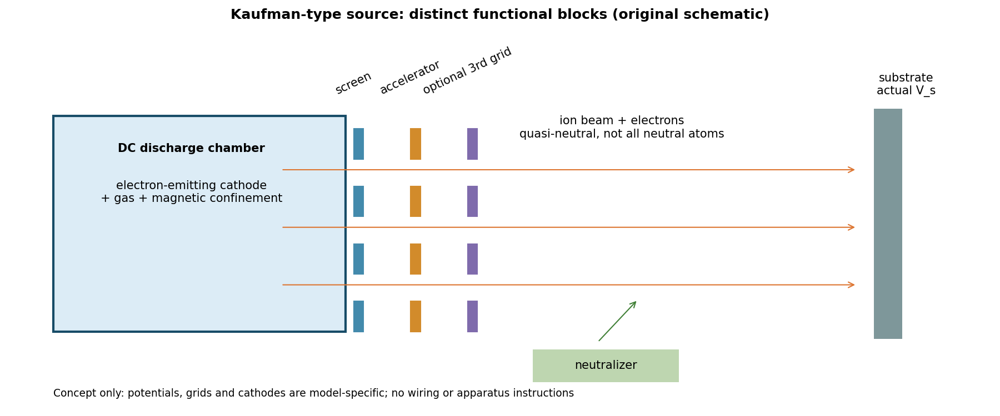

# T10 离子源与薄膜制造工程手册 第一轮

版本T10-r1-v0.1.0；2026-10-02；状态ready_for_review。优先Kaufman栅控源，保留源端设定、基片实际粒子/能流、材料响应三层证据。已形成9章正文、29条来源登记/摘要、16种膜材/基片条件卡、16项检验和12类故障矩阵，以及50项数值/结构测试。

核心结论：不存在脱离源型、粒种/电荷态、基片电位、几何、温度、净沉积与测试波段的通用最优电压电流。End-Hall、RF栅控和DC Kaufman严格分开；实际生产参数保持未知。本轮是有限资料研究及合成验证，不是实机资格、工艺放行或标准认证。全部专题首轮验收由协调者决定。

## 阅读入口

1. [来源索引和证据等级](reports/00_source_index.md)
2. [Kaufman源结构与束物理](reports/01_kaufman_source_and_beam_physics.md)
3. [通量 能流 注量和离原子比](reports/02_flux_energy_dose_normalization.md)
4. [计量 校准与二维映射](reports/03_metrology_calibration_and_mapping.md)
5. [全部优先材料与基片条件矩阵](reports/04_conditional_material_matrix.md)
6. [生长机制 副作用与多层膜](reports/05_growth_mechanisms_and_stack_effects.md)
7. [试验设计与受约束参数优化](reports/06_experiment_design_and_optimization.md)
8. [安全 异常与适用限制](reports/07_safety_failure_modes_and_limits.md)
9. [合成算例和复现](reports/08_numerical_demonstrations_and_reproduction.md)
10. [跨专题接口和第二轮backlog](reports/09_cross_topic_interfaces_and_round1_backlog.md)

## 图和可复用数据

图为原创概念示意，不能用于设备接线或改装。另有[合成空间图](figures/synthetic_spatial_fields.svg)和[计量/热负载诊断](figures/synthetic_diagnostics.svg)。

- data/material_response_matrix.json和CSV：12膜材+4基片；逐项Ar/O2、已证实/未知、测试门槛，无生产配方
- data/ion_assist_record.schema.json与measurement_record_template.json：单位、位置、能量定义、电荷态、证据链与安全/资格字段
- data/test_matrix.csv、failure_diagnosis_matrix.csv：检验设计及根因区分清单；客户阈值、严酷度、样本数不擅自填入
- data/demo_results.json、synthetic_maps.npz、synthetic_time_history.csv：明确合成结果
- [独立来源核查](reviews/independent_source_check.md)、[本轮自审](reviews/SELF_REVIEW.md)、[首轮移交](reviews/ROUND1_ACCEPTANCE.md)
- [T01第二轮入口](T01_ROUND2_HANDOFF.md)：只在全部十专题首轮验收后启动

## 复现

    python -m unittest discover -s tests -v
    python benchmarks/run_benchmarks.py
    python benchmarks/plot_figures.py
    python models/check_package.py

分享阅读包不含local-only原文，最后一条应改为：

    python models/check_package.py --reader

reader模式只跳过原文存在/哈希检查，其余结构、来源引用、冻结依赖与数值一致性检查保持不变；本地研究库默认模式仍核原文。

models核心仅Python标准库；benchmark需NumPy/Matplotlib；数据schema测试需jsonschema。结果记录和运行时版本见reviews与data；不安装软件、不操作设备、不改产品代码、不push。

## 权利与分享边界

只有核到合法保存依据的原文才存入sources/originals；当前NASA-CR-165334有官方公共使用记录，仍按项目local-only政策排除全部原文。其余第三方手册/论文以链接、原创摘要和访问等级移交；公开可读不自动等于再分发许可。所有sources/originals及其派生全文不得进入分享包。详见[sources/README](sources/README.md)。
