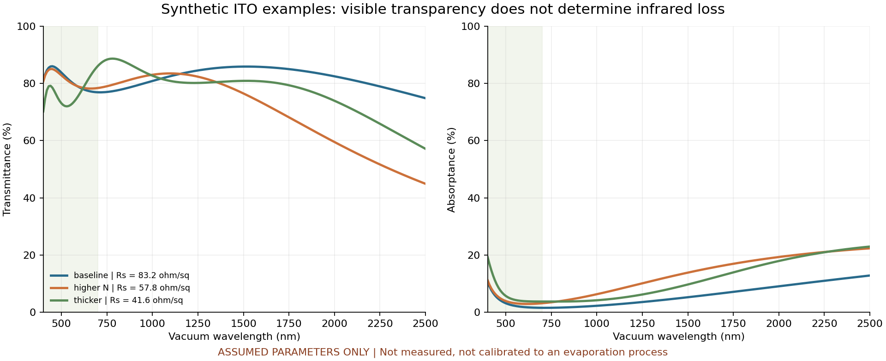

# 合成光谱用于理解权衡

图采用电光章节完全相同的三组人为输入与CSV，不附加文献拟合。左图为穿过前膜及无损非相干玻璃后的透过率，右图为系统吸收率；400–700 nm浅色区只是示意可见波段。较低方阻可以伴随更大的近红外吸收，但这个图不能用于把某个氧压、温度或Sn配比映射到性能。其他参数、相干边界和局限详见电光章节。

若目标是中红外，当前400–2500 nm演示域必须停止，需另取目标材料/状态的宽谱数据与合适带间/声子模型。模型不是越过已声明波段继续画曲线就获得了有效性。
